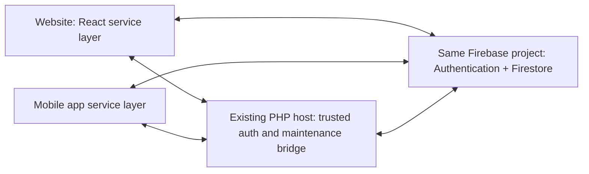

# Firebase migration analysis — Phase 2, Prompt 1

Analysis date: **2026-11-10, Asia/Manila (UTC+08:00)**. This is an inventory of the current React/PHP/MySQL application, not a Firebase implementation or a final collection design.

## Scope, sources and safe inspection

Read `AGENTS.md` and `docs/progress.md` first. Inspected the DDL in [database/barangay_survey.sql](../database/barangay_survey.sql), the schema/bootstrap body of [config/db.php](../config/db.php), [config/functions.php](../config/functions.php), all 32 `api/lib/*.php` modules, [api/index.php](../api/index.php), and React routes, guards, API calls and search components. SQL dump INSERT data was excluded from the analysis. No account rows, credentials, password hashes, photos or service account key are reproduced here.

The dump and bootstrap together define **15 tables and 257 effective columns**. The dump already includes the self-healed additions; the initial eight-table definitions in PHP alone are not the full schema. Direct read-only live metadata inspection confirmed the same 15 table names and the same 257 column names/types, with two additional live-only indexes noted below. No application bootstrap was executed for this inspection.

For live row counts, a temporary CLI reader parsed only the literal MySQL connection settings in memory, connected directly, and used a repeatable-read, read-only consistent-snapshot transaction. Its only application-table reads were `SELECT COUNT(*)`; other reads accessed schema metadata. It rolled back/closed the read transaction. This avoided `config/db.php`'s automatic schema changes, seed insertion, duplicate deletion and backfills. No Firebase service account key was accessed; no Firebase project was contacted or created. No production write, import, reset, fixture creation or destructive operation was performed.

## 1. Complete table and column inventory

All tables use InnoDB and utf8mb4. The dump specifies `utf8mb4_general_ci`, so comparisons and unique string keys use that collation rather than JavaScript string equality. Integer `(11)` is the declared display width, not an 11-digit business limit. `tinyint(1)` is SQL numeric storage, not an enforced Boolean-only domain. Defaults/nullability below are the declared effective schema; auto-increment counters and dump row data are intentionally omitted.

Origin legend: **B** = column in one of PHP's eight base-table definitions; **H** = column added or modified by self-healing `ALTER TABLE`; **C** = column in a PHP-created extension table/shared column template. Every column also appears in the current SQL dump. `residents.gender` and `staff.gender` are initially added as `varchar(10)` by older checks, then widened to `varchar(20)`; the effective type below is the final one. `birthdate` and `residency_status` are redundantly guarded by `ensure_resident_birthdate_column()` as well.

Column definitions include SQL type, nullability, default and auto-increment. Keys are listed separately after each table. There are no declared CHECK constraints or explicit ON UPDATE CASCADE actions. Foreign keys have the default restrictive update behavior (confirmed as RESTRICT live). References without an actual foreign key are identified in §2.

### 1.1. `residents`

Account, identity, household, permanent/temporary address and archive state. Family singleton fields are stored directly here, not as separate spouse/parent records. Resident Number is unique even for archived rows; email/contact are not unique.

| Column | Effective SQL definition | Origin |
| --- | --- | --- |
| `resident_id` | `int(11) NOT NULL AUTO_INCREMENT` | B |
| `resident_number` | `varchar(20) NOT NULL` | B |
| `courtesy_title` | `varchar(20) DEFAULT NULL` | H |
| `first_name` | `varchar(50) NOT NULL` | B |
| `middle_name` | `varchar(50) DEFAULT NULL` | H |
| `last_name` | `varchar(50) NOT NULL` | B |
| `name_extension` | `varchar(20) DEFAULT NULL` | H |
| `email` | `varchar(100) DEFAULT NULL` | B |
| `contact_number` | `varchar(20) DEFAULT NULL` | B |
| `birthdate` | `date DEFAULT NULL` | H |
| `gender` | `varchar(20) DEFAULT NULL` | H |
| `address` | `varchar(255) DEFAULT NULL` | B |
| `photo_path` | `varchar(255) DEFAULT NULL` | H |
| `residency_status` | `varchar(20) NOT NULL DEFAULT 'permanent'` | H |
| `residency_start_date` | `date DEFAULT NULL` | H |
| `password` | `varchar(255) NOT NULL` | B |
| `is_first_login` | `tinyint(1) NOT NULL DEFAULT 1` | B |
| `created_at` | `timestamp NOT NULL DEFAULT current_timestamp()` | B |
| `category_reference` | `varchar(60) DEFAULT NULL` | H |
| `occupation` | `varchar(100) DEFAULT NULL` | H |
| `hotline_number` | `varchar(30) DEFAULT NULL` | H |
| `is_married` | `tinyint(1) NOT NULL DEFAULT 0` | H |
| `spouse_last_name` | `varchar(50) DEFAULT NULL` | H |
| `spouse_first_name` | `varchar(50) DEFAULT NULL` | H |
| `spouse_middle_name` | `varchar(50) DEFAULT NULL` | H |
| `spouse_name_extension` | `varchar(20) DEFAULT NULL` | H |
| `has_children` | `tinyint(1) NOT NULL DEFAULT 0` | H |
| `father_last_name` | `varchar(50) DEFAULT NULL` | H |
| `father_first_name` | `varchar(50) DEFAULT NULL` | H |
| `father_middle_name` | `varchar(50) DEFAULT NULL` | H |
| `father_name_extension` | `varchar(20) DEFAULT NULL` | H |
| `mother_last_name` | `varchar(50) DEFAULT NULL` | H |
| `mother_first_name` | `varchar(50) DEFAULT NULL` | H |
| `mother_middle_name` | `varchar(50) DEFAULT NULL` | H |
| `mother_name_extension` | `varchar(20) DEFAULT NULL` | H |
| `spouse_courtesy_title` | `varchar(20) DEFAULT NULL` | H |
| `spouse_gender` | `varchar(20) DEFAULT NULL` | H |
| `father_courtesy_title` | `varchar(20) DEFAULT NULL` | H |
| `father_gender` | `varchar(20) DEFAULT NULL` | H |
| `mother_courtesy_title` | `varchar(20) DEFAULT NULL` | H |
| `mother_gender` | `varchar(20) DEFAULT NULL` | H |
| `birthplace` | `varchar(150) DEFAULT NULL` | H |
| `special_category` | `varchar(20) NOT NULL DEFAULT 'none'` | H |
| `is_active` | `tinyint(1) NOT NULL DEFAULT 1` | H |
| `household_number` | `varchar(50) DEFAULT NULL` | H |
| `purok` | `varchar(100) DEFAULT NULL` | H |
| `street_highway` | `varchar(150) DEFAULT NULL` | H |
| `barangay` | `varchar(100) DEFAULT NULL` | H |
| `municipality` | `varchar(100) DEFAULT NULL` | H |
| `postal_code` | `varchar(10) DEFAULT NULL` | H |
| `province` | `varchar(100) DEFAULT NULL` | H |
| `residence_type` | `varchar(5) DEFAULT NULL` | H |
| `temporary_address` | `varchar(255) DEFAULT NULL` | H |
| `temp_household_number` | `varchar(50) DEFAULT NULL` | H |
| `temp_purok` | `varchar(100) DEFAULT NULL` | H |
| `temp_street_highway` | `varchar(150) DEFAULT NULL` | H |
| `temp_barangay` | `varchar(100) DEFAULT NULL` | H |
| `temp_municipality` | `varchar(100) DEFAULT NULL` | H |
| `temp_postal_code` | `varchar(10) DEFAULT NULL` | H |
| `temp_province` | `varchar(100) DEFAULT NULL` | H |
| `deleted_at` | `datetime DEFAULT NULL` | H |
| `deleted_by` | `int(11) DEFAULT NULL` | H |
| `deleted_by_name` | `varchar(100) DEFAULT NULL` | H |
| `delete_reason` | `varchar(255) DEFAULT NULL` | H |

Declared keys and constraints:

- ``PRIMARY KEY (`resident_id`)``.
- ``UNIQUE KEY `resident_number` (`resident_number`)``.
- No declared foreign key.


### 1.2. `staff`

Staff and admin share this table. Username is unique even for archived rows. **staff_number is nullable and has no index or unique constraint in the dump/bootstrap/live database.** `created_by`, `deleted_by` are logical staff references without FKs. Legacy onboarding defaults differ from explicitly created staff values.

| Column | Effective SQL definition | Origin |
| --- | --- | --- |
| `staff_id` | `int(11) NOT NULL AUTO_INCREMENT` | B |
| `staff_number` | `varchar(20) DEFAULT NULL` | H |
| `username` | `varchar(50) NOT NULL` | B |
| `full_name` | `varchar(100) NOT NULL` | B |
| `courtesy_title` | `varchar(20) DEFAULT NULL` | H |
| `first_name` | `varchar(50) DEFAULT NULL` | H |
| `middle_name` | `varchar(50) DEFAULT NULL` | H |
| `last_name` | `varchar(50) DEFAULT NULL` | H |
| `name_extension` | `varchar(20) DEFAULT NULL` | H |
| `password` | `varchar(255) NOT NULL` | B |
| `role` | `varchar(30) NOT NULL DEFAULT 'staff'` | B |
| `created_at` | `timestamp NOT NULL DEFAULT current_timestamp()` | B |
| `is_active` | `tinyint(1) NOT NULL DEFAULT 1` | H |
| `position` | `varchar(100) DEFAULT NULL` | H |
| `date_hired` | `date DEFAULT NULL` | H |
| `contact_number` | `varchar(20) DEFAULT NULL` | H |
| `email` | `varchar(100) DEFAULT NULL` | H |
| `birthdate` | `date DEFAULT NULL` | H |
| `license_number` | `varchar(50) DEFAULT NULL` | H |
| `gender` | `varchar(20) DEFAULT NULL` | H |
| `address` | `varchar(255) DEFAULT NULL` | H |
| `emergency_contact` | `varchar(150) DEFAULT NULL` | H |
| `emergency_contact_name` | `varchar(100) DEFAULT NULL` | H |
| `emergency_contact_number` | `varchar(20) DEFAULT NULL` | H |
| `photo_path` | `varchar(255) DEFAULT NULL` | H |
| `household_number` | `varchar(50) DEFAULT NULL` | H |
| `purok` | `varchar(100) DEFAULT NULL` | H |
| `street_highway` | `varchar(150) DEFAULT NULL` | H |
| `barangay` | `varchar(100) DEFAULT NULL` | H |
| `municipality` | `varchar(100) DEFAULT NULL` | H |
| `postal_code` | `varchar(10) DEFAULT NULL` | H |
| `province` | `varchar(100) DEFAULT NULL` | H |
| `is_first_login` | `tinyint(1) NOT NULL DEFAULT 0` | H |
| `profile_completed` | `tinyint(1) NOT NULL DEFAULT 1` | H |
| `created_by` | `int(11) DEFAULT NULL` | H |
| `deleted_at` | `datetime DEFAULT NULL` | H |
| `deleted_by` | `int(11) DEFAULT NULL` | H |
| `deleted_by_name` | `varchar(100) DEFAULT NULL` | H |
| `delete_reason` | `varchar(255) DEFAULT NULL` | H |

Declared keys and constraints:

- ``PRIMARY KEY (`staff_id`)``.
- ``UNIQUE KEY `username` (`username`)``.
- No declared foreign key.


### 1.3. `surveys`

`created_by` is a logical reference to staff, with no FK. Status has only active/inactive, not draft. The schema does not require start_date <= end_date.

| Column | Effective SQL definition | Origin |
| --- | --- | --- |
| `survey_id` | `int(11) NOT NULL AUTO_INCREMENT` | B |
| `title` | `varchar(150) NOT NULL` | B |
| `description` | `text DEFAULT NULL` | B |
| `start_date` | `date NOT NULL` | B |
| `end_date` | `date NOT NULL` | B |
| `status` | `enum('active','inactive') NOT NULL DEFAULT 'active'` | B |
| `created_by` | `int(11) DEFAULT NULL` | B |
| `created_at` | `timestamp NOT NULL DEFAULT current_timestamp()` | B |

Declared keys and constraints:

- ``PRIMARY KEY (`survey_id`)``.
- No declared foreign key.


### 1.4. `survey_questions`

Question type is an SQL ENUM; question_order is neither unique nor constrained positive. Deleting a question cascades to choices, but not directly to survey_results.question_id.

| Column | Effective SQL definition | Origin |
| --- | --- | --- |
| `question_id` | `int(11) NOT NULL AUTO_INCREMENT` | B |
| `survey_id` | `int(11) NOT NULL` | B |
| `question_text` | `varchar(255) NOT NULL` | B |
| `question_type` | `enum('multiple_choice','yesno','rating','short_answer') NOT NULL` | B |
| `question_order` | `int(11) NOT NULL DEFAULT 0` | B |

Declared keys and constraints:

- ``PRIMARY KEY (`question_id`)``.
- ``KEY `survey_id` (`survey_id`)``.
- ``CONSTRAINT `fk_question_survey` FOREIGN KEY (`survey_id`) REFERENCES `surveys` (`survey_id`) ON DELETE CASCADE``.


### 1.5. `survey_choices`

No unique constraint on question/text or enforced minimum number of choices. Deleting a choice does not cascade to survey_results.choice_id, which has no FK.

| Column | Effective SQL definition | Origin |
| --- | --- | --- |
| `choice_id` | `int(11) NOT NULL AUTO_INCREMENT` | B |
| `question_id` | `int(11) NOT NULL` | B |
| `choice_text` | `varchar(150) NOT NULL` | B |

Declared keys and constraints:

- ``PRIMARY KEY (`choice_id`)``.
- ``KEY `question_id` (`question_id`)``.
- ``CONSTRAINT `fk_choice_question` FOREIGN KEY (`question_id`) REFERENCES `survey_questions` (`question_id`) ON DELETE CASCADE``.


### 1.6. `responses`

The unique (survey_id,resident_id) pair is the actual concurrency guarantee for one response. It is added by bootstrap if missing. Deleting a survey/resident cascades through responses to survey_results.

| Column | Effective SQL definition | Origin |
| --- | --- | --- |
| `response_id` | `int(11) NOT NULL AUTO_INCREMENT` | B |
| `survey_id` | `int(11) NOT NULL` | B |
| `resident_id` | `int(11) NOT NULL` | B |
| `submitted_at` | `timestamp NOT NULL DEFAULT current_timestamp()` | B |

Declared keys and constraints:

- ``PRIMARY KEY (`response_id`)``.
- ``UNIQUE KEY `uniq_response_per_resident` (`survey_id`,`resident_id`)``.
- ``KEY `survey_id` (`survey_id`)``.
- ``KEY `resident_id` (`resident_id`)``.
- ``CONSTRAINT `fk_response_resident` FOREIGN KEY (`resident_id`) REFERENCES `residents` (`resident_id`) ON DELETE CASCADE``.
- ``CONSTRAINT `fk_response_survey` FOREIGN KEY (`survey_id`) REFERENCES `surveys` (`survey_id`) ON DELETE CASCADE``.


### 1.7. `survey_results`

Only response_id has an FK. question_id is indexed but not constrained to survey_questions; choice_id is neither indexed nor an FK. There is no unique (response_id,question_id), no SQL rating range check, and no constraint tying a choice/question to the response survey.

| Column | Effective SQL definition | Origin |
| --- | --- | --- |
| `answer_id` | `int(11) NOT NULL AUTO_INCREMENT` | B |
| `response_id` | `int(11) NOT NULL` | B |
| `question_id` | `int(11) NOT NULL` | B |
| `choice_id` | `int(11) DEFAULT NULL` | B |
| `rating_value` | `int(11) DEFAULT NULL` | B |
| `answer_text` | `text DEFAULT NULL` | B |

Declared keys and constraints:

- ``PRIMARY KEY (`answer_id`)``.
- ``KEY `response_id` (`response_id`)``.
- ``KEY `question_id` (`question_id`)``.
- ``CONSTRAINT `fk_result_response` FOREIGN KEY (`response_id`) REFERENCES `responses` (`response_id`) ON DELETE CASCADE``.


### 1.8. `login_history`

Polymorphic (user_type,user_id) has no FK and no composite/index support beyond the primary key. event is varchar, not an ENUM; login/logout and account_role values are PHP conventions. History can survive account purge.

| Column | Effective SQL definition | Origin |
| --- | --- | --- |
| `log_id` | `int(11) NOT NULL AUTO_INCREMENT` | B |
| `user_type` | `enum('resident','staff') NOT NULL` | B |
| `user_id` | `int(11) NOT NULL` | B |
| `login_time` | `timestamp NOT NULL DEFAULT current_timestamp()` | B |
| `ip_address` | `varchar(50) DEFAULT NULL` | B |
| `event` | `varchar(10) NOT NULL DEFAULT 'login'` | H |
| `account_role` | `varchar(20) DEFAULT NULL` | H |

Declared keys and constraints:

- ``PRIMARY KEY (`log_id`)``.
- No declared foreign key.


### 1.9. `resident_children`

Created from the shared person-row template. The PHP creator retries table creation without its FK on failure; the dump and inspected live table do have the cascade. No unique display_order.

| Column | Effective SQL definition | Origin |
| --- | --- | --- |
| `child_id` | `int(11) NOT NULL AUTO_INCREMENT` | C |
| `resident_id` | `int(11) NOT NULL` | C |
| `courtesy_title` | `varchar(20) DEFAULT NULL` | H |
| `last_name` | `varchar(50) DEFAULT NULL` | C |
| `first_name` | `varchar(50) DEFAULT NULL` | C |
| `middle_name` | `varchar(50) DEFAULT NULL` | C |
| `name_extension` | `varchar(20) DEFAULT NULL` | C |
| `display_order` | `int(11) NOT NULL DEFAULT 0` | C |
| `created_at` | `timestamp NOT NULL DEFAULT current_timestamp()` | C |
| `gender` | `varchar(20) DEFAULT NULL` | H |

Declared keys and constraints:

- ``PRIMARY KEY (`child_id`)``.
- ``KEY `resident_id` (`resident_id`)``.
- ``CONSTRAINT `resident_children_ibfk_1` FOREIGN KEY (`resident_id`) REFERENCES `residents` (`resident_id`) ON DELETE CASCADE``.


### 1.10. `resident_character_references`

Same shared person-row template and FK fallback as children, with reference_id instead of child_id. First name/surname required by PHP, although SQL permits NULL.

| Column | Effective SQL definition | Origin |
| --- | --- | --- |
| `reference_id` | `int(11) NOT NULL AUTO_INCREMENT` | C |
| `resident_id` | `int(11) NOT NULL` | C |
| `courtesy_title` | `varchar(20) DEFAULT NULL` | H |
| `last_name` | `varchar(50) DEFAULT NULL` | C |
| `first_name` | `varchar(50) DEFAULT NULL` | C |
| `middle_name` | `varchar(50) DEFAULT NULL` | C |
| `name_extension` | `varchar(20) DEFAULT NULL` | C |
| `display_order` | `int(11) NOT NULL DEFAULT 0` | C |
| `created_at` | `timestamp NOT NULL DEFAULT current_timestamp()` | C |
| `gender` | `varchar(20) DEFAULT NULL` | H |

Declared keys and constraints:

- ``PRIMARY KEY (`reference_id`)``.
- ``KEY `resident_id` (`resident_id`)``.
- ``CONSTRAINT `resident_character_references_ibfk_1` FOREIGN KEY (`resident_id`) REFERENCES `residents` (`resident_id`) ON DELETE CASCADE``.


### 1.11. `resident_update_requests`

Resident name/address/birthdate proposals. Includes legacy email/contact and barangay_subdivision columns, even though current application of approvals is selective. Only PK: no FK, resident/status index or pending uniqueness.

| Column | Effective SQL definition | Origin |
| --- | --- | --- |
| `request_id` | `int(11) NOT NULL AUTO_INCREMENT` | C |
| `resident_id` | `int(11) NOT NULL` | C |
| `first_name` | `varchar(50) DEFAULT NULL` | H |
| `last_name` | `varchar(50) DEFAULT NULL` | H |
| `email` | `varchar(100) DEFAULT NULL` | C |
| `contact_number` | `varchar(20) DEFAULT NULL` | C |
| `address` | `varchar(255) DEFAULT NULL` | C |
| `household_number` | `varchar(50) DEFAULT NULL` | H |
| `barangay_subdivision` | `varchar(100) DEFAULT NULL` | H |
| `municipality` | `varchar(100) DEFAULT NULL` | H |
| `province` | `varchar(100) DEFAULT NULL` | H |
| `status` | `varchar(20) NOT NULL DEFAULT 'pending'` | C |
| `submitted_at` | `timestamp NOT NULL DEFAULT current_timestamp()` | C |
| `reviewed_at` | `datetime DEFAULT NULL` | C |
| `reviewed_by` | `int(11) DEFAULT NULL` | C |
| `review_comment` | `varchar(255) DEFAULT NULL` | C |
| `temporary_address` | `varchar(255) DEFAULT NULL` | H |
| `temp_household_number` | `varchar(50) DEFAULT NULL` | H |
| `temp_purok` | `varchar(100) DEFAULT NULL` | H |
| `temp_street_highway` | `varchar(150) DEFAULT NULL` | H |
| `temp_barangay` | `varchar(100) DEFAULT NULL` | H |
| `temp_municipality` | `varchar(100) DEFAULT NULL` | H |
| `temp_postal_code` | `varchar(10) DEFAULT NULL` | H |
| `temp_province` | `varchar(100) DEFAULT NULL` | H |
| `purok` | `varchar(100) DEFAULT NULL` | H |
| `street_highway` | `varchar(150) DEFAULT NULL` | H |
| `barangay` | `varchar(100) DEFAULT NULL` | H |
| `postal_code` | `varchar(10) DEFAULT NULL` | H |
| `previous_address` | `varchar(255) DEFAULT NULL` | H |
| `courtesy_title` | `varchar(20) DEFAULT NULL` | H |
| `middle_name` | `varchar(50) DEFAULT NULL` | H |
| `name_extension` | `varchar(20) DEFAULT NULL` | H |
| `birthdate` | `date DEFAULT NULL` | H |

Declared keys and constraints:

- ``PRIMARY KEY (`request_id`)``.
- No declared foreign key.


### 1.12. `resident_family_requests`

payload is LONGTEXT carrying PHP-produced JSON, not a JSON SQL column or schema-validated object. PHP creation can fall back to no FK; dump/live have the cascade. No unique constraint limiting one pending request.

| Column | Effective SQL definition | Origin |
| --- | --- | --- |
| `request_id` | `int(11) NOT NULL AUTO_INCREMENT` | C |
| `resident_id` | `int(11) NOT NULL` | C |
| `payload` | `longtext NOT NULL` | C |
| `reason` | `varchar(255) DEFAULT NULL` | C |
| `status` | `varchar(20) NOT NULL DEFAULT 'pending'` | C |
| `requested_at` | `timestamp NOT NULL DEFAULT current_timestamp()` | C |
| `reviewed_at` | `datetime DEFAULT NULL` | C |
| `reviewed_by` | `int(11) DEFAULT NULL` | C |
| `reviewed_by_name` | `varchar(100) DEFAULT NULL` | C |
| `review_comment` | `varchar(255) DEFAULT NULL` | C |

Declared keys and constraints:

- ``PRIMARY KEY (`request_id`)``.
- ``KEY `resident_id` (`resident_id`)``.
- ``KEY `status` (`status`)``.
- ``CONSTRAINT `resident_family_requests_ibfk_1` FOREIGN KEY (`resident_id`) REFERENCES `residents` (`resident_id`) ON DELETE CASCADE``.


### 1.13. `resident_delete_requests`

Snapshot fields preserve number/name and requester/reviewer names after a resident or staff row is purged. No FK or pending uniqueness. Approval archives rather than hard-deletes.

| Column | Effective SQL definition | Origin |
| --- | --- | --- |
| `request_id` | `int(11) NOT NULL AUTO_INCREMENT` | C |
| `resident_id` | `int(11) NOT NULL` | C |
| `resident_number` | `varchar(20) DEFAULT NULL` | C |
| `resident_name` | `varchar(120) DEFAULT NULL` | C |
| `reason` | `varchar(255) NOT NULL` | C |
| `requested_by` | `int(11) DEFAULT NULL` | C |
| `requested_by_name` | `varchar(100) DEFAULT NULL` | C |
| `status` | `varchar(20) NOT NULL DEFAULT 'pending'` | C |
| `requested_at` | `timestamp NOT NULL DEFAULT current_timestamp()` | C |
| `reviewed_at` | `datetime DEFAULT NULL` | C |
| `reviewed_by` | `int(11) DEFAULT NULL` | C |
| `reviewed_by_name` | `varchar(100) DEFAULT NULL` | C |
| `review_comment` | `varchar(255) DEFAULT NULL` | C |

Declared keys and constraints:

- ``PRIMARY KEY (`request_id`)``.
- No declared foreign key.


### 1.14. `staff_update_requests`

Post-onboarding address proposals with staff identity and previous-address snapshots. Only PK; no FK or pending uniqueness.

| Column | Effective SQL definition | Origin |
| --- | --- | --- |
| `request_id` | `int(11) NOT NULL AUTO_INCREMENT` | C |
| `staff_id` | `int(11) NOT NULL` | C |
| `staff_number` | `varchar(20) DEFAULT NULL` | C |
| `staff_name` | `varchar(120) DEFAULT NULL` | C |
| `household_number` | `varchar(50) DEFAULT NULL` | C |
| `purok` | `varchar(100) DEFAULT NULL` | C |
| `street_highway` | `varchar(150) DEFAULT NULL` | C |
| `barangay` | `varchar(100) DEFAULT NULL` | C |
| `municipality` | `varchar(100) DEFAULT NULL` | C |
| `postal_code` | `varchar(10) DEFAULT NULL` | C |
| `province` | `varchar(100) DEFAULT NULL` | C |
| `address` | `varchar(255) DEFAULT NULL` | C |
| `previous_address` | `varchar(255) DEFAULT NULL` | C |
| `reason` | `varchar(255) DEFAULT NULL` | C |
| `status` | `varchar(20) NOT NULL DEFAULT 'pending'` | C |
| `submitted_at` | `timestamp NOT NULL DEFAULT current_timestamp()` | C |
| `reviewed_at` | `datetime DEFAULT NULL` | C |
| `reviewed_by` | `int(11) DEFAULT NULL` | C |
| `reviewed_by_name` | `varchar(100) DEFAULT NULL` | C |
| `review_comment` | `varchar(255) DEFAULT NULL` | C |

Declared keys and constraints:

- ``PRIMARY KEY (`request_id`)``.
- No declared foreign key.


### 1.15. `resident_residency_changes`

Permanent/temporary transition audit and both prior addresses. No resident/actor FK, so audit rows survive hard deletion. prev_residence_type is varchar(50), wider than residents.residence_type varchar(5).

| Column | Effective SQL definition | Origin |
| --- | --- | --- |
| `change_id` | `int(11) NOT NULL AUTO_INCREMENT` | C |
| `resident_id` | `int(11) NOT NULL` | C |
| `from_status` | `varchar(20) NOT NULL` | C |
| `to_status` | `varchar(20) NOT NULL` | C |
| `reason` | `text DEFAULT NULL` | C |
| `changed_by` | `int(11) DEFAULT NULL` | C |
| `changed_at` | `datetime NOT NULL DEFAULT current_timestamp()` | C |
| `is_reverted` | `tinyint(1) NOT NULL DEFAULT 0` | C |
| `prev_address` | `varchar(255) DEFAULT NULL` | C |
| `prev_household_number` | `varchar(50) DEFAULT NULL` | C |
| `prev_purok` | `varchar(100) DEFAULT NULL` | C |
| `prev_street_highway` | `varchar(150) DEFAULT NULL` | C |
| `prev_barangay` | `varchar(100) DEFAULT NULL` | C |
| `prev_municipality` | `varchar(100) DEFAULT NULL` | C |
| `prev_postal_code` | `varchar(10) DEFAULT NULL` | C |
| `prev_province` | `varchar(100) DEFAULT NULL` | C |
| `prev_temporary_address` | `varchar(255) DEFAULT NULL` | C |
| `prev_temp_household_number` | `varchar(50) DEFAULT NULL` | C |
| `prev_temp_purok` | `varchar(100) DEFAULT NULL` | C |
| `prev_temp_street_highway` | `varchar(150) DEFAULT NULL` | C |
| `prev_temp_barangay` | `varchar(100) DEFAULT NULL` | C |
| `prev_temp_municipality` | `varchar(100) DEFAULT NULL` | C |
| `prev_temp_postal_code` | `varchar(10) DEFAULT NULL` | C |
| `prev_temp_province` | `varchar(100) DEFAULT NULL` | C |
| `prev_residence_type` | `varchar(50) DEFAULT NULL` | C |

Declared keys and constraints:

- ``PRIMARY KEY (`change_id`)``.
- ``KEY `resident_id` (`resident_id`)``.
- ``KEY `changed_at` (`changed_at`)``.
- No declared foreign key.

### 1.16. Bootstrap additions, repairs and live drift

Source: `config/db.php` and the small schema helper in `config/functions.php`.

| Operation | What must be accounted for in migration |
| --- | --- |
| Database/base initialization | Creates the database if absent, then eight base tables: staff, residents, surveys, survey_questions, survey_choices, responses, survey_results, login_history. Seeds an administrator only when staff is completely empty. Seed credentials are omitted here; do not replay initialization during an audit. |
| First ALTER pass | Adds resident identity/residency/family/category/activity fields, staff employment/name/contact/address/onboarding fields, and login event/role fields. Each checks SHOW COLUMNS before adding; failures are logged and tolerated. |
| Response uniqueness repair | If uniq_response_per_resident is absent, groups duplicate (survey_id,resident_id), keeps MIN(response_id), deletes later responses (and cascaded answer rows), then adds the unique key. **This is destructive self-healing**, not a read-only operation. It was not executed for this task. |
| Extension tables | Creates resident_children, resident_character_references, resident_family_requests, resident_residency_changes, resident_update_requests, resident_delete_requests and staff_update_requests. Person/family tables retry without foreign keys on FK creation failure. Other extension tables intentionally have no FKs. |
| Staff Number backfill | Finds NULL/empty staff_number ordered by staff_id, obtains global MAX numeric suffix among S-% values, and updates missing numbers using current year plus increasing suffix. It does not add a unique staff_number index. |
| Second ALTER pass | Rechecks prior additions and adds resident permanent/temporary address parts, courtesy title, request proposal fields, archive columns on both account tables, courtesy title and gender on repeatable family tables. |
| Address backfill | Reads residents with missing household_number and a nonempty legacy address; splits only exact four-part comma-separated addresses into household_number/barangay/municipality/province. Other strings are left for manual correction. |
| Staff emergency backfill | Copies nonempty legacy emergency_contact into emergency_contact_name only if the latter is empty. |
| Gender repair | Widens residents.gender/staff.gender to varchar(20), then migrates male→man and female→woman. No ENUM remains on these columns. |
| Local clock | PHP uses Asia/Manila; MySQL session uses +08:00. DATE fields, CURDATE(), NOW() and timestamp grouping depend on this business timezone. |
| Additional live indexes | The inspected database has nonunique idx_residents_deleted_at on residents(deleted_at) and idx_staff_deleted_at on staff(deleted_at). Neither is declared by the remaining SQL dump or current bootstrap. All other inspected index shapes and all eight FK edges agree with the inventory above. |

The 15 table names, 257 column names/types, nullable/default declarations, key declarations and all self-healing ADD/MODIFY targets are covered above. Bootstrap fallback behavior means a different installation cannot be assumed to have all intended FKs merely because PHP contains their DDL.

## 2. Relationships, cascades and archive semantics

“Logical” below means application convention only: MySQL does not enforce it as an FK.

| Parent / relationship | Child or reference | Cardinality and enforcement |
| --- | --- | --- |
| residents.resident_id | responses.resident_id | One resident → many responses; FK ON DELETE CASCADE. Combined survey/resident pair is unique. |
| surveys.survey_id | responses.survey_id | One survey → many responses; FK ON DELETE CASCADE. |
| surveys.survey_id | survey_questions.survey_id | One survey → many ordered questions; FK ON DELETE CASCADE. |
| survey_questions.question_id | survey_choices.question_id | One question → many choices; FK ON DELETE CASCADE. Multiple-choice semantics are PHP-only. |
| responses.response_id | survey_results.response_id | One response → many answer rows; FK ON DELETE CASCADE. |
| survey_questions.question_id | survey_results.question_id | Logical only, indexed. No direct cascade. Deleting a single question may leave answer rows until their response is deleted. |
| survey_choices.choice_id | survey_results.choice_id | Optional logical reference only, no FK/cascade. A removed choice may leave a dangling answer choice_id. |
| staff.staff_id | surveys.created_by; staff.created_by | Logical creator references only; staff can author many surveys/accounts. Purging staff does not remove surveys/accounts. |
| residents.resident_id | resident_children.resident_id; resident_character_references.resident_id | One → many ordered people; cascade in dump/live, optional in PHP fallback. Parents/spouse are resident columns, not links to resident/staff account rows. |
| residents.resident_id | resident_family_requests.resident_id | One → many proposals; cascade in dump/live, optional in PHP fallback. JSON payload embeds family snapshots/arrays. |
| residents.resident_id | resident_update_requests.resident_id; resident_delete_requests.resident_id; resident_residency_changes.resident_id | Logical only; no FK/cascade. Update queues use INNER JOIN and can hide orphan requests. Deletion/audit lists use LEFT JOIN and preserve history/fallback labels. |
| staff.staff_id | staff_update_requests.staff_id | Logical only; proposal retains staff_number/staff_name snapshots. |
| staff.staff_id | *.reviewed_by; resident_delete_requests.requested_by; resident_residency_changes.changed_by; residents/staff.deleted_by | Logical actor references; nullable IDs and stored names where present. No actor deletion cascade. resident_update_requests has no reviewed_by_name column. |
| residents/staff PK | login_history(user_type,user_id) | Polymorphic logical relationship. Two LEFT JOINs resolve live names/roles; account_role snapshots capture event-time role/residency. No FK/cascade. |

Hard-deleting a **survey** removes its questions→choices and responses→survey_results. Hard-deleting a **resident** removes responses→survey_results, and (where the FKs exist) children, references and family requests. It does not remove resident_update_requests, resident_delete_requests, resident_residency_changes or login_history. Hard-deleting **staff** has no declared downstream FK cascade. Application purge does not perform a general dependent-table/photo cleanup; do not assume it does.

Soft deletion is different: `archive_account()` stamps `deleted_at`, `deleted_by`, `deleted_by_name`, `delete_reason`; it does not delete related data or change is_active. Most account lists/login predicates use `deleted_at IS NULL`. `restore_account()` clears only those four fields: it does not reactivate a deactivated account, reset its password, or clear onboarding flags. Deleted Accounts is a view of those same rows, not a separate archive table. `resident_residency_changes` is a separate address/transition archive, not an account-deletion archive.

Firestore references are not SQL foreign keys; whichever collection design is chosen must explicitly preserve the intended reference validation and cleanup policy. Deleting a Firestore document does not automatically delete its subcollection documents. [Firebase deletion documentation](https://firebase.google.com/docs/firestore/manage-data/delete-data).

## 3. Business rules and guarantees to carry forward

These are observed SQL/PHP/React behaviors. Firestore Authentication and document storage do not automatically reproduce them. Where current enforcement differs from intent, the difference is recorded rather than silently changing behavior.

| Rule | Current enforcement and exact scope | Migration requirement / gap |
| --- | --- | --- |
| One response per resident/survey | responses UNIQUE(survey_id,resident_id), a preflight existence read, transactional response+answer insertion; duplicate-key 1062 quietly returns to survey list. | A check-then-create query alone is unsafe. Needs an atomic uniqueness mechanism shared by web/mobile, such as a deterministic pair document and transaction/rules. |
| Survey availability | SQL status='active' AND CURDATE() BETWEEN start_date AND end_date; PHP survey_is_open uses inclusive start/end against local today. Form read and submission recheck; already-answered surveys cannot be submitted again. | Reproduce Asia/Manila date semantics and enforce on trusted writes, not only hidden form controls. Current preflight checks occur before the insert transaction; they are not a survey-row lock against simultaneous staff edits. |
| Submission normalization | Reads only the survey's questions. Yes/No whitelist; ratings integer-cast and limited to 1–5; short text trimmed; wholly empty normalized submission rejected. Inserts surviving answers and response atomically. React requires multiple-choice/yesno/rating fields; PHP permits a partial submission if at least one answer survives. | Preserve actual validation layer differences. Current PHP parses choice_ IDs without checking that the choice exists/belongs to the question; SQL also lacks that FK. No per-response/question unique key. Any hardening needs a separate explicit decision. |
| Single-form identity | Trim; exact case-insensitive R-YYYY-NNNN → residents.resident_number only; exact S-YYYY-NNNN → staff.staff_number only; anything else → staff.username only. Number identifiers uppercase, no table/column fallback; client portal/type ignored. | Keep identity mapping independent of client hints. Existing MySQL collation supplies case-insensitive username lookup and uniqueness; Firestore document/string matching does not inherit this collation. No password or hash belongs in readable profile documents. |
| Login error/status | Unknown ID, wrong password and archived account use the same generic error. Valid password on inactive account gives role-specific deactivation message. PHP password_verify; successful login regenerates session ID and logs the event. | Firebase Auth alone does not reproduce custom identifier lookup, profile archive/active gates, messages or audit history. Migration of existing PHP password hashes/authentication needs a separate supported plan; none was attempted. |
| First-login password | New residents default is_first_login=1; new staff explicitly 1. Reset writes a hash of the account number and sets first-login=1. Password save verifies current password, policy, different new/current, confirmation; staff cannot choose Staff Number as new password (case-insensitive). Policy: >=8 bytes, uppercase, lowercase, number, no whitespace. | Firebase login does not enforce this app flag/redirect/policy automatically. Keep onboarding state protected; do not let arbitrary profile writes clear it. |
| Password routing | api_next_route/authDestination prioritize first-login → role change-password, then staff incomplete profile → complete-profile, else role dashboard. Resident first-login access restriction is in React guards; api_resident_id only checks identity/type. | A UI redirect is not server authorization. Document the resident API gap before choosing Firebase rules. Staff general API routes use the server gate. |
| Staff onboarding | New account username initially equals Staff Number, role staff, active=1, first-login=1, profile_completed=0. Most staff APIs require password/profile complete. Own profile/photo and password/session/logout are onboarding exemptions. Legacy staff columns default first-login=0/profile_completed=1. | Preserve two-stage flow and exemption behavior. Profile save can occur before password change but the first-login gate remains. Admin profile save is denied; admin profile is a read-only record. |
| Session revalidation | PHP refreshes current account by PK. Missing/archived identities log out. An inactive resident session is rejected; an already signed-in staff session is not rechecked for is_active. Staff identity wins if legacy session contains both account IDs. | Auth state, archive state and role checks need an explicit equivalent; do not claim current staff deactivation instantly revokes existing sessions. |
| Authorization | Own resident identity is session-derived; response access requires response_id AND resident_id. Any onboarded staff can manage surveys/questions/residents; no created_by ownership restriction. Admin-only staff creation/actions, archive restore/purge, residency promote/revert/records, staff-address/deletion review and privileged stat views. | Authentication alone grants none of these role permissions. Enforce in rules/trusted service and tests, not only React route/menu visibility. |
| Family-review discrepancy | Address Requests only returns family/staff queues to admins. api_request_review restricts kind=staff/deletion to admins, but kind=family is callable by any onboarded staff. | Preserve/document the actual API/UI difference; no new permission policy chosen here. Resident-update review is available to staff/admin. |
| Account archive / restore / purge | Archive retains responses; restore clears archive stamps only; purge requires archived row and admin, self-purge forbidden for staff. Deletion-request history can be marked '[Account later restored.]'. | No implicit soft delete, archive query filter or dependent cleanup in Firestore; reproduce filters per query rather than globally erasing historical participation. |
| Last administrator / self-actions | Staff toggle/archive/reset reject own ID. Archive of another admin checks active_admin_count excluding target. Staff toggle does not apply the last-admin check; archive count/target lock is not a global admin-set lock. | Do not overstate the existing guarantee; race/toggle gaps are migration review items, not fixes in this document. |
| Resident Number allocation | MAX unsigned numeric final suffix across all residents, including archives and all years, +1; current year in R- prefix, minimum four-character padding, uniqueness precheck and DB unique index. No allocator lock; concurrent adds may collide and one insert fails. Purging highest number can allow suffix reuse. | Need explicit shared allocation and uniqueness design; not a yearly-reset counter. Padding does not cap suffix at four digits, while current login detector requires exactly four; >9999 is an existing compatibility gap. |
| Staff Number allocation | generate_staff_number uses MAX final suffix among staff_number LIKE 'S-%', all years/archives. API creation wraps generation+insert with GET_LOCK('barangay_api_staff_number',10)/RELEASE_LOCK. Username initially equals number (username unique); staff_number itself is not unique. Bootstrap backfills missing numbers without that API lock. | A shared atomic allocator must cover both apps; no MySQL GET_LOCK in Firestore. Preserve legacy usernames; handle nonunique/NULL number fields deliberately. Same >9999/purge reuse limitations apply. |
| Resident proposals | Name/address and birthdate share one pending resident_update_requests gate. Owner row lock serializes submissions. Pending request leaves resident unchanged. Contact email/number is self-service and writes immediately. Family proposals have a separate pending gate and LONGTEXT JSON payload. | Need protected pending-state transitions and atomic submission, with separate proposal categories matching current behavior. Pending uniqueness is PHP locking, not SQL unique keys. Deletion-request pending precheck lacks equivalent locking/unique key and can race. |
| Approval transaction | Locks target then pending request; only pending can be decided. Approval selectively writes carried fields and status/reviewer/time/comment together; rejection leaves target data unchanged. Staff/deletion rejection requires reason; resident/family comment optional. Family approval replaces both repeatable tables with scalar family updates in one transaction. | Carry atomicity and reviewer authority across apps. Do not let clients approve themselves or modify approved payloads outside authorized actions. Birthdate-only approval must not clear names/addresses. Family payload must decode before decision. |
| Deletion approval | Archives resident; stores decision and reviewer, resolves other pending deletion requests for same resident to approved. Direct admin archive also resolves pending deletion requests. | Multiple documents/derived statuses must remain consistent; preserve surviving audit snapshots rather than FK-deleting the audit. |
| Staff profile/address | Profile contact/email/birthdate/gender/license/emergency updates save immediately and set profile_completed=1. First address saves directly on onboarding; later changed address requires reason and a pending staff_update_requests row. While pending, existing address is retained. Admin approval applies parts and rebuilt display address. | Separate self-service fields from reviewed address fields; enforce only one pending staff address via atomic operation. Existing pending check is PHP target-row serialization. |
| Residency qualification | Minimum six whole months, valid not-future residency_start_date, not before birthdate. Temporary type whitelist AR/DR/BH/BS/RL/TR; permanent clears temporary type/address. Editing keeps stored status authoritative; changing status requires admin action. Existing permanent start date unchanged is exempt from rechecking six months in edit. | Date/transition checks and address clearing are application policy, not document types. Preserve explicit edit exception. |
| Promotion / reversion | Admin locks resident; promotion requires temporary status, temporary address and eligible duration. Logs both prior addresses, copies temporary→permanent, clears temporary fields. Reversion requires reason; finds latest unreverted promotion, restores old permanent address, carries current permanent into temporary, marks promotion reverted, appends audit. No promotion fallback retains current permanent and copies it to temporary when reverting. | Atomic state+snapshot writes needed; do not reduce this to flipping residency_status. Clarify fallback data-entry message while preserving current flow. |
| Resident/family validation | Required resident first/middle/last names, birthdate, gender, birthplace and address parts; optional fields normalize/clear per form. Add/edit require spouse first/surname if married, child if has_children, and at least one character reference. Repeatable people require first/surname, blank rows removed; No marriage/children clears dependent fields. Category reference formats and lengths enforced; none clears reference. | SQL nullable columns do not capture these rules. Family-request validation differs: spouse first name/reference/reason checks are present; not every add/edit validation is repeated. Do not assume one universal validator currently exists. |
| Address/contact validation | Required household_number/barangay/municipality/province; display address derived from seven parts. Contact format, address max lengths, postal-code/category-reference patterns and title/gender options come from helpers; staff email uses FILTER_VALIDATE_EMAIL. Not every path applies identical checks (e.g. resident edit omits add's postal regex). | Preserve semantics/validation messages; record path differences rather than relying on Firestore field typing. |
| Photo policy | SQL stores photo_path only; files live in uploads. React cropper creates compressed JPEG avatar. PHP validates actual image and extension JPG/JPEG/PNG/GIF/WEBP; staff has 5 MB cap, resident has only PHP upload limits. Staff replacement removes old file; resident replacement retains it. Removal unlinks file and nulls path. | Firebase Storage remains unconfirmed; under Phase 2 rules use small compressed Firestore images if unavailable, with explicit size/access policy later. Existing paths are not image bytes; this task did not read uploads or migrate images. |
| Audit/time/display | Successful login/logout inserts type, ID, IP, event and event-time account_role; current names resolved on read with fallback for deleted accounts. Counts/date labels use local clock and source-specific filters. | Keep event-time snapshots and source limits. A client timestamp/role/IP claim is not automatically trustworthy. No Cloud Functions or paid audit service is proposed. |
| SQL structure | Auto-increment PKs, unique resident number/username/response pair, ENUMs, NOT NULL/defaults, referential cascades and SQL transactions. | Firestore requires explicit ID/reference/schema/uniqueness/atomic-write policies. A service layer organizes access but does not secure it by itself. |

Firestore can atomically read/write multiple documents in transactions; Security Rules can validate allowed operations and related state. Exact collection/rule design and emulator tests belong to later prompts. [Transactions](https://firebase.google.com/docs/firestore/manage-data/transactions), [Security Rules conditions](https://firebase.google.com/docs/firestore/security/rules-conditions).

## 4. Query patterns grouped by screen

**J** = SQL join, correlated subquery, EXISTS/NOT EXISTS, or PHP composition of related records. **A** = aggregate/group/distinct/ranking. **E** = SQL expression/date transformation or application-side derived result. **L** = ordinary filtered/ordered lookup/list. **S** = browser substring search/filter. Repeated calls are intentionally described once per behavior. Appendix A contains all 145 SELECT-bearing literal/interpolated SQL expressions in API/shared helpers, including duplicates used by different handlers; dynamic SELECT projections are expanded explicitly below. Mutation behavior and transactional validation reads are included here as well as in §3.

All data-backed screens also use shared session validation. Public Landing and Not Found have no data query of their own; compatibility/legacy-family routes redirect and inherit the destination's queries. CSV/print views reuse the documented response/report loaders. No general SQL LIKE name search, full-text index, or SQL pagination is used by the React table controls.

### 4.1. Shared authentication, shells and password screens

Sources: `auth.php`, `session.php`, `config/functions.php`; `AuthProvider.jsx`, `authRedirect.js`.

| Screen/action | Pattern and scope | Needs |
| --- | --- | --- |
| Single login | Exactly one nonarchived account lookup, resident_number or staff_number or username, LIMIT 1. | L; custom identity mapping, collation-aware lookup |
| Session / every protected request | SELECT account by resident_id/staff_id LIMIT 1; role/archive/current state projection; filesystem photo-existence check. Staff/resident identity not taken from request body. | L/E |
| Admin sidebar badges | COUNT pending resident_delete_requests; sum of two COUNT subqueries for archived resident+staff accounts. | A; two collection aggregates/composition |
| Login/logout activity write | Read staff.role or resident.residency_status by ID; INSERT login_history snapshot with event/IP; logout clears session. | L plus write; event-time role |
| Change password | Read own account/hash, validate, UPDATE password/is_first_login, reload session; no password/hash in API user projection. | L plus write; onboarding flags |

### 4.2. Resident Dashboard and stat-detail

Sources: `resident.php`, `resident-stats.php`, `fetch_person_rows()`.

| Pattern | Scope, ordering and limits | Needs |
| --- | --- | --- |
| Available headline/completion | COUNT surveys active and date-open with NOT EXISTS response for this resident; COUNT all own responses. Standalone resident/stats repeats these. | A+J (anti-join) |
| Assigned/completion derived figures | Headline assigned_total = currently available + all historical own responses; percent from those values. Assigned detail instead lists only currently open active surveys, with EXISTS answered flag. | E/J; preserve this headline/detail mismatch |
| Upcoming list | Same open/unanswered anti-join, ORDER BY end_date ASC LIMIT 5. | J+L |
| Own record | Resident by PK. Children and references by resident_id ordered display_order,created_at. Household count computed from loaded arrays/spouse flag. | L+J/E (separate reads, no SQL join) |
| Activity chart | Responses for resident and submitted_at >= DATE_SUB(CURDATE(), INTERVAL 5 MONTH); GROUP BY DATE_FORMAT(submitted_at,'%Y-%m'), COUNT. PHP fills six monthly labels with zeros. | A+E |
| Recent submissions | responses JOIN surveys, own resident_id, submitted_at DESC LIMIT 5. | J+L |
| Residency progress | PHP duration in months from own residency_start_date; six-month target, percent capped at 100, next deadline/days-left formatting. | E; no separate aggregate query |
| Available detail | Open/unanswered surveys with description, end_date ASC; no LIMIT. | J+L |
| Completed detail | Own responses JOIN surveys, submitted_at DESC; no LIMIT. | J+L |
| Assigned detail | Open surveys with EXISTS own response, answered ASC then end_date ASC. | J+L |

### 4.3. Resident Surveys, Survey Form, submission, confirmation

Sources: `surveys.php`, `survey-submit.php`.

| Pattern | Scope, ordering and limits | Needs |
| --- | --- | --- |
| Survey list | Active/date-open surveys, correlated EXISTS for own response, start_date DESC. PHP splits answered/open lists. | J+L/E |
| Submitted banner / Confirmation | Optional title lookup by survey_id; fallback title. A title lookup is not response-ownership validation. | L |
| Form/preflight | Survey by PK; SELECT 1 response WHERE survey_id and own resident_id; survey-open check. Questions ordered question_order,question_id; choices queried per multiple-choice question. | L+J; N+1 related reads |
| Submit | Repeats survey/existence check; reads all survey questions (no order required); transaction INSERT response and each normalized answer; unique race handled. | L+J plus atomic writes |

### 4.4. Resident History, View Response, Print and CSV

Source: `survey-responses.php`.

| Pattern | Scope, ordering and limits | Needs |
| --- | --- | --- |
| History | responses INNER JOIN surveys, own resident_id, submitted_at DESC, all rows. | J+L |
| Response authorization/header | responses INNER JOIN surveys, response_id AND own resident_id, LIMIT 1. | J+L; owner check |
| Answer expansion | survey_questions LEFT JOIN survey_results on question AND requested response; LEFT JOIN survey_choices; question survey_id obtained from response subquery; question_order,question_id ASC. Includes unanswered current questions. | J+L; preserve missing-choice/unanswered display |
| Download/print | Same authorized loader; display/CSV mapping of choice_text/rating/answer_text, no new aggregate. | E |

### 4.5. Resident Profile and requests/photos

Sources: `profile.php`, `profile-requests.php`, `profile-photo.php`, family helpers.

| Pattern | Scope, ordering and limits | Needs |
| --- | --- | --- |
| Profile | Own resident by PK (allowlisted serialization); children and references by resident_id ordered display_order,created_at; age/title/address labels derived. | L+J/E |
| Pending name/address/birthdate | request_id for resident, status pending, LIMIT 1. | L; existence |
| Pending family indicator | request_id,requested_at for resident/status pending, requested_at DESC LIMIT 1. | L |
| Proposal creation checks | SELECT resident FOR UPDATE; pending update LIMIT 1 or pending family list; insert proposal only after validation. | L plus transaction/locking |
| Immediate contact/photo | Update own contact or photo_path; photo lock uses SELECT resident FOR UPDATE. Reload profile/pending/people after success. | L+J plus writes; files outside SQL |

### 4.6. Staff/Admin Dashboard

Sources: `staff-dashboard.php`, `staff-stats.php`.

| Pattern | Exact scope/shape | Needs |
| --- | --- | --- |
| Main metrics | COUNT all surveys; COUNT active/date-open surveys; COUNT nonarchived residents; COUNT all responses; COUNT pending resident_update_requests. | A |
| Facts/period deltas | COUNT inactive surveys; COUNT end_date < CURDATE() (independent of status); MAX submitted_at; response counts >=today−7 days and [today−14,today−7); nonarchived resident created_at >=today−30; average responses per survey and delta text in PHP. | A+E |
| Residency split | GROUP BY residency_status, COUNT nonarchived residents; PHP treats any value other than temporary as permanent. | A+E |
| Recent survey table/chart | surveys LEFT JOIN responses, GROUP BY survey identity/metadata, COUNT(response_id), survey created_at DESC LIMIT 8. | J+A |
| Eligible/participation | COUNT active and nonarchived residents; COUNT DISTINCT resident_id from all responses, without current account filter; ratio capped 100. | A+E; distinct needs explicit strategy |
| Completion rankings | Active-status surveys LEFT JOIN responses, COUNT per survey, answered DESC LIMIT 6; **no open-date predicate**; denominator eligible residents. | J+A+E |
| Top responders | responses JOIN residents, COUNT per resident, answered DESC then last_name ASC LIMIT 5. **No deleted_at/is_active filter.** | J+A; derived top-N ordering |
| Admin metrics only | Nonarchived staff count, inactive/nonarchived staff and residents counts, pending deletion request count. | A; admin authorization |
| Recent login/logout panels | login_history LEFT JOIN residents and staff by user_type, event='login' or 'logout', login_time DESC LIMIT 10 each. COALESCE current name/fallback; account_role snapshot preferred by helper. Portal rails counted in PHP from these ten rows, not all history. | J+L+A/E |
| Status/question mix | COUNT surveys GROUP BY status; COUNT survey_questions GROUP BY question_type ORDER BY count DESC. | A |
| Daily trend | DATE(submitted_at) BETWEEN normalized from/to, GROUP BY DATE, COUNT; default 30-day range, swaps reversed dates, max span 365 days (366 inclusive points); PHP zero-fill. | A+E |
| Age bands | TIMESTAMPDIFF(YEAR,birthdate,CURDATE()) for nonarchived nonnull birthdates; SUM CASE for under18/18–34/35–59/60+. | A+E |
| Gender | GROUP BY COALESCE(NULLIF(gender,''),'unstated'), COUNT nonarchived residents; map allowed labels, append unrecorded. | A+E |
| Priority groups | GROUP BY COALESCE(NULLIF(special_category,''),'none'), COUNT nonarchived residents. | A+E |
| Occupation top7 | Nonarchived nonempty TRIM occupation, exclude uppercase N/A/NA/NONE; GROUP BY UPPER(TRIM(occupation)); COUNT DESC, display job ASC LIMIT 7. | A+E; normalization and ranking |
| Purok top7 | Nonarchived nonempty TRIM purok; GROUP BY UPPER(TRIM(purok)); COUNT DESC, area ASC LIMIT 7. | A+E |
| Household bars | Nonarchived residents COUNT plus SUM CASE is_married=1 / has_children=1; complements computed in PHP. | A+E |

These demographics count resident records/flags; they are not SQL joins to resident_children or distinct real-world household entities. A resident archive removes them from demographic counts immediately but leaves historical responses/top-responder/participation scopes as above.

### 4.7. Staff stat-detail views

Source: `staff-stat-detail.php`. Unknown/unauthorized views redirect. The eight views are exhaustive.

| View | Pattern | Needs |
| --- | --- | --- |
| total_surveys | surveys LEFT JOIN responses, COUNT grouped per survey, created_at DESC, no limit. | J+A |
| active_surveys | Active/date-open surveys LEFT JOIN responses, COUNT grouped per survey, DATEDIFF(end_date,CURDATE()), end_date ASC. | J+A+E |
| total_residents | Nonarchived residents ordered last_name,first_name. | L |
| total_responses | responses JOIN surveys LEFT JOIN residents, submitted_at DESC LIMIT 200. | J+L |
| staff_accounts (admin) | Nonarchived staff, role ASC,full_name ASC. | L |
| deactivated_residents (admin) | is_active=0 AND nonarchived, last_name ASC. | L |
| deactivated_staff (admin) | is_active=0 AND nonarchived, full_name ASC. | L |
| recent_logins (admin) | Polymorphic history LEFT JOINs, login_time DESC LIMIT 100. **No event filter and no account_role projection**, so this includes logout events and uses current joined role/residency labels. recent_logouts is not a supported view. | J+L/E; differs from dashboard panels |

### 4.8. Staff Surveys, Add/Edit Survey and Question Management

Sources: `staff-surveys.php`, `staff-questions.php`; `SurveyTable.jsx`.

| Pattern | Scope/order and mutations | Needs |
| --- | --- | --- |
| Survey Management | All surveys ordered created_at DESC with correlated COUNT responses by survey. Search across title/start_date/end_date/status and All/Active/Inactive filters run in browser. | J+A+S |
| Add/edit metadata | Read survey by PK; validate title/description/date order; create survey/questions/choices in transaction; update fields/status; toggle with SQL IF. | L plus writes |
| Delete survey | SELECT title FOR UPDATE then DELETE survey; SQL cascades remove questions/choices/responses/answers. | L plus transaction/cascade |
| Questions/read preview | Survey by PK; questions by survey_id, question_order,question_id ASC; choices per multiple-choice question by choice_id ASC. | L+J; related read composition |
| Question create | Lock owning survey; MAX(question_order)+1 (COALESCE 0); insert question/choices. Initial survey creation uses nonempty question list and does not repeat Question Management's five-character/minimum-two-choice checks. | A/L plus writes |
| Question update/choice validation | Question WHERE question_id AND survey_id; read owned choice IDs; update question and retained choice texts, delete blank choices, insert new; switching type deletes choices. | L+J plus transaction |
| Move/delete/resequence | Neighbor by survey_id and question_order < or > current, nearest ASC/DESC LIMIT 1, swap orders; delete constrained by owning survey, reload ordered questions, update consecutive order values. | L+E plus transaction |

### 4.9. Staff Results, Reports, CSV

Sources: `staff-results.php`, `staff-report-export.php`, `TextAnswerList.jsx`.

| Pattern | Scope/order/limits | Needs |
| --- | --- | --- |
| Survey selector/header | survey_id,title for all surveys created_at DESC; selected survey by PK. Report header LEFT JOINs staff creator; Results/CSV use survey row without that join. | L; report J |
| Respondent count | COUNT responses WHERE survey_id. Does not filter resident archive/activation. | A |
| Ordered questions | All survey questions ordered question_order ASC (not explicit question_id tie-break). Per-question queries below. | L+J composition |
| Multiple-choice breakdown | Choices LEFT JOIN answers by choice_id, WHERE choice.question_id, GROUP BY choice_id,text COUNT(answer_id), includes zero-count choices. No independent response-survey/account filter. | J+A |
| Yes/No Results | Answers WHERE question_id AND answer_text IN Yes/No, GROUP BY answer_text COUNT; PHP fills both options with zeros. | A+E |
| Rating Results | AVG(rating_value), COUNT(rating_value) for question/non-NULL; group rating_value COUNT ordered rating; PHP fills 1–5, rounds average to 2 decimals. | A+E |
| Short-answer Results | Answers LEFT JOIN responses for submitted_at; question filter, nonempty/non-NULL text, answer_id DESC LIMIT 200. Search is lowercase substring over **only those loaded 200** in browser; no date-filter control in current TextAnswerList. | J+L+S |
| Printable Report | MC same join; Yes/No and rating use synthetic UNION ALL option tables LEFT JOIN answers, GROUP BY option to include zero rows; short answers all nonempty without limit/order/date join. | J+A; short-answer L |
| CSV Report | MC zero choices retained by join; Yes/No and rating GROUP BY observed answers only (zero options not synthesized); all nonempty short answers with no 200 cap. | J+A/L; preserve report/CSV difference |
| Chart highlights | PHP totals votes, percentage by votes, max/tied winner; report answered_here is sum votes or count text rows. | A/E over query results |

### 4.10. Registered Resident, Add/Edit, residency and deletion actions

Sources: `staff-residents.php`, `staff-resident-add.php`, `staff-resident-detail.php`, `staff-resident-update.php`, `staff-resident-actions.php`, `staff-resident-residency.php`.

| Pattern | Scope/order and action | Needs |
| --- | --- | --- |
| Resident list | All nonarchived residents ordered resident_number,last_name,first_name. Separate pending-deletion resident_id list; PHP composes badges/flags and searchText. | L+J/E |
| Resident list filters | Browser trimmed lowercase substring over resident number/name; combine All/Permanent/Temporary/Pending Login/Deactivated token filter. No server SQL search. | S |
| Add resident | Global MAX numeric suffix; uniqueness existence check; INSERT resident then replace children/references transactionally. | A/L plus writes |
| Edit lookup | Dynamic allowlist projection from residents WHERE resident_id AND nonarchived LIMIT 1; people via helper. Admin also reads latest unreverted permanent-transition prev_address, changed_at DESC/change_id DESC LIMIT 1. | L+J |
| Edit save | SELECT residency_status,residency_start_date FOR UPDATE; validate with saved status; update scalar fields and replace repeatable people together. | L plus transaction |
| Password reset / activation | Read resident number then update password/first-login; read active flag for nonarchived ID then toggle. These specific resident-management helpers do not hold a row lock across the read/write. | L plus writes |
| Direct archive | Admin reads live name; conditional archive UPDATE; mark all pending deletion requests approved with reviewer. | L plus related writes |
| Request deletion | Read nonarchived resident number/name; pending request EXISTS LIMIT 1; insert reason/requester/identity snapshots if absent. No unique key/transaction serializing this pending precheck. | L+J plus write |
| Promote | SELECT resident FOR UPDATE; check duration/temp address; INSERT transition snapshot and UPDATE both address sets/status atomically. | L+E plus transaction |
| Revert | Lock resident; latest unreverted permanent transition ordered changed_at DESC/change_id DESC LIMIT 1; restore/carry address, mark old log reverted and append new log. | L+J/E plus transaction |

### 4.11. Address Requests, Family review, Deletion Requests

Sources: `request-lists.php`, `request-review.php`, `request-apply.php`.

| Pattern | Scope/order | Needs |
| --- | --- | --- |
| Resident update queue | resident_update_requests INNER JOIN residents, pending boolean DESC then submitted_at DESC; all statuses, no account archive filter. Name/address projection and legacy barangay fallback in PHP. | J+L/E |
| Staff address queue (admin display) | staff_update_requests snapshots, pending DESC then submitted_at DESC, all statuses; no staff join. | L |
| Family queue (admin display) | resident_family_requests INNER JOIN residents, pending DESC/requested_at DESC; PHP decodes JSON/expands people and counts pending. | J+L/E |
| Deletion queue | resident_delete_requests LEFT JOIN residents for existence/deleted_at, pending DESC/requested_at DESC. PHP detects later restoration and current archive state; all statuses. | J+L/E |
| Queue summary counts | Total/pending counts computed from loaded arrays; no additional GROUP BY in these screens. | A/E in application |
| Review action validation | Request→target ID lookup; target row FOR UPDATE; request WHERE id AND pending FOR UPDATE; selective apply, review stamp and related deletion resolutions. | L+J plus transaction |
| Family approval | Decode stored payload; UPDATE resident family fields and delete/reinsert children/references. Pending proposal and scalar/repeated data commit together. | J composition plus transaction |

### 4.12. Deleted Accounts and Residency Records (admin)

Source: `account-archive.php`.

| Pattern | Scope/order | Needs |
| --- | --- | --- |
| Archived residents | deleted_at IS NOT NULL, deleted_at DESC; correlated COUNT responses for each archived resident. | J+A+L |
| Archived staff | deleted_at IS NOT NULL, deleted_at DESC; snapshot display name. | L/E |
| Restore/purge | Lock target PK; conditional archive-clear or DELETE WHERE archived; resident restore appends marker to approved deletion requests. Restoring does not set is_active=1. | L plus writes/cascades |
| Residency audit | resident_residency_changes LEFT JOIN residents LEFT JOIN staff, changed_at DESC/change_id DESC; current identity/status, historical address snapshot, missing-record fallback. | J+L/E |
| Audit filter/count/search | Promotion/reversion counts computed across all fetched records before PHP to_status filter (permanent/temporary). Browser trimmed lowercase resident number/name substring on filtered rows. No SQL WHERE for filter/search. | A/E+S |

### 4.13. User Management and Staff Profile/onboarding

Sources: `staff-users.php`, `staff-profile.php`, `staff-profile-save.php`, `staff-photo.php`, `active_admin_count()`.

| Pattern | Scope/order | Needs |
| --- | --- | --- |
| Staff account table (admin) | Nonarchived staff ordered role DESC,full_name; searchText includes number/username/name. Onboarding badges derived from flags. Browser search only. | L+E+S |
| Resident account table | Nonarchived residents ordered last_name,first_name; browser number/full-name search. | L+S |
| New staff | Acquire named lock, MAX global S-number suffix, insert fixed role/initial username/password state, release lock; one-time handover response. | A/L plus writes/locking |
| Staff actions | SELECT target staff FOR UPDATE; no-self check, archive checks active_admin_count (COUNT normalized admin role/live/active excluding target), update active/password/archive. | L+A plus transaction |
| Resident toggle from Users | SELECT live resident is_active FOR UPDATE then UPDATE. | L plus transaction; unlike resident-management toggle |
| Own staff profile | Dynamic projection of employment/contact/address/flags by own staff_id; non-admin pending address/status query ordered submitted_at DESC LIMIT 1. | L+J |
| Profile save | Lock own staff row, read pending request LIMIT 1 FOR UPDATE; immediate contact/profile-completed update; first address direct or later proposal INSERT. | L plus transaction |
| Staff photo | SELECT photo_path by own ID FOR UPDATE; image validation/filesystem write/replace/remove plus UPDATE photo_path; reload own profile/session. | L plus writes/E |

### 4.14. Background/bootstrap query patterns (not a screen)

Schema SHOW TABLES/SHOW COLUMNS/SHOW INDEX probes; CREATE/ALTER DDL; empty-staff LIMIT 1 seed check; duplicate-response GROUP BY/HAVING COUNT/MIN and joined DELETE; missing-staff-number list and MAX suffix; legacy resident address list; conditional backfill UPDATEs; gender-column inspection and conversions. These are enumerated in §1.16 and were not executed. The future migration must not carry the self-healing side effects into ordinary reads.

### 4.15. Firestore implications of this query workload

For a future Firebase **Core/Standard-style** implementation, ordinary equality/range/order/limit lookups can be expressed as indexed collection queries. The actual existing Firebase database/edition has not been inspected in this task; no second project/database is proposed. Do not assume MySQL joins, GROUP BY, COUNT DISTINCT, collation, SQL date functions, synthetic option tables or subquery/anti-join expressions transfer directly into Core queries. The grouped inventory above identifies the operations requiring explicit related reads, aggregation/composition or a later approved denormalized model. [Firebase query documentation](https://firebase.google.com/docs/firestore/query-data/queries).

Firestore provides count(), sum() and average() aggregation queries. This can support simple filtered totals/means; it is not a one-call replacement for this app's grouped rankings, distinct participants, zero-filled time buckets or joins. SQL MAX/latest queries and grouped top-N may require sorted reads or maintained summaries. Any derived summaries would need atomic, authorized updates from both apps because Cloud Functions are excluded by the Spark-only project rules; no implementation choice is made here. [Firebase aggregation documentation](https://firebase.google.com/docs/firestore/query-data/aggregation-queries).

Current browser substring search is part of the behavior baseline: preserve which records are loaded, searched and ordered. Replacing it with a prefix query changes results. No paid external search service, Cloud Function, second Firebase project or Firebase Storage provisioning is authorized. Web/mobile access must eventually pass through each app's src/services layer, with authorization independently enforced by the backend/rules. All future writes and rule validation must be emulator-tested before the real project.

## 5. Live row counts (counts only)

Snapshot: **2026-11-10 18:26:46 Asia/Manila, UTC+08:00**. Counts include every row, including archived/inactive accounts and every request status; these are table sizes, not the dashboard's filtered business metrics. Dump AUTO_INCREMENT values and INSERT statements were not used as row counts. No names, identifiers, contacts, addresses, answer text, account hashes or connection settings were queried from application rows.

| Table | Rows |
| --- | ---: |
| `residents` | 4 |
| `staff` | 3 |
| `surveys` | 5 |
| `survey_questions` | 16 |
| `survey_choices` | 12 |
| `responses` | 5 |
| `survey_results` | 16 |
| `login_history` | 69 |
| `resident_children` | 1 |
| `resident_character_references` | 4 |
| `resident_update_requests` | 100 |
| `resident_family_requests` | 0 |
| `resident_delete_requests` | 0 |
| `staff_update_requests` | 0 |
| `resident_residency_changes` | 0 |

Counts are a point-in-time observation and may change through normal application use. All 15 tables were read successfully in one read-only consistent snapshot. Metadata checks additionally found all 257 source columns with matching types, eight live cascading FK edges and the two live-only archive indexes described in §1.16.

## Appendix A. SQL read-expression catalogue by screen area

This catalogue is extracted from PHP tokens without executing application files. Values are SQL source templates, not executed queries or application data. `$variables`, `{$variables}`, `%s` and `?` remain placeholders. The survey lookup's optional `FOR UPDATE` suffix is appended by PHP and described in §4.8. Shared query helpers are expanded in §4. Each occurrence retains its source line so repeated patterns can be traced. A/J flags use the definitions in §4; expressions such as COUNT subqueries are both A and J even when the source has no literal JOIN.

Dynamic projections not recoverable from a standalone SELECT string are: `api_staff_profile_data()` selecting its explicit `$columns` allowlist from staff by staff_id; `api_staff_resident_detail()` selecting its explicit `$columns` allowlist from live residents by resident_id LIMIT 1. Their selected field lists were inspected and their related lookups are in §§4.10/4.13. `api_account()`, login, review target queries, family reads, and dynamic neighbor queries keep their internal table/column placeholders below. No raw request field becomes a SQL table/column name.

### Deleted Accounts / Residency Records — `api/lib/account-archive.php`

1. **A/J** — `api/lib/account-archive.php:9`

   ```sql
   SELECT r.resident_id, r.resident_number, r.courtesy_title, r.first_name, r.last_name, r.residency_status, r.deleted_at, r.deleted_by_name, r.delete_reason, (SELECT COUNT(*) FROM responses rs WHERE rs.resident_id = r.resident_id) AS response_count FROM residents r WHERE r.deleted_at IS NOT NULL ORDER BY r.deleted_at DESC
   ```

2. **L** — `api/lib/account-archive.php:13`

   ```sql
   SELECT staff_id, staff_number, username, courtesy_title, full_name, role, deleted_at, deleted_by_name, delete_reason FROM staff WHERE deleted_at IS NOT NULL ORDER BY deleted_at DESC
   ```

3. **L** — `api/lib/account-archive.php:33`

   ```sql
   SELECT $key FROM $kind WHERE $key = ? FOR UPDATE
   ```

4. **J** — `api/lib/account-archive.php:54`

   ```sql
   SELECT c.change_id, c.resident_id, c.from_status, c.to_status, c.prev_address, c.prev_temporary_address, c.reason, c.changed_at, c.is_reverted, r.resident_number, r.first_name, r.last_name, r.residency_status, s.full_name AS changed_by_name FROM resident_residency_changes c LEFT JOIN residents r ON r.resident_id = c.resident_id LEFT JOIN staff s ON s.staff_id = c.changed_by ORDER BY c.changed_at DESC, c.change_id DESC
   ```


### Shared authentication — `api/lib/auth.php`

5. **L** — `api/lib/auth.php:32`

   ```sql
   SELECT * FROM $table WHERE $column = ? AND deleted_at IS NULL LIMIT 1
   ```


### Resident Profile — `api/lib/profile-requests.php`

6. **L** — `api/lib/profile-requests.php:79`

   ```sql
   SELECT request_id FROM resident_family_requests WHERE resident_id = ? AND status = 'pending'
   ```


### Resident Profile — `api/lib/profile.php`

7. **L** — `api/lib/profile.php:22`

   ```sql
   SELECT * FROM residents WHERE resident_id = ?
   ```

8. **L** — `api/lib/profile.php:46`

   ```sql
   SELECT request_id FROM resident_update_requests WHERE resident_id = ? AND status = 'pending' LIMIT 1
   ```

9. **L** — `api/lib/profile.php:47`

   ```sql
   SELECT request_id, requested_at FROM resident_family_requests WHERE resident_id = ? AND status = 'pending' ORDER BY requested_at DESC LIMIT 1
   ```

10. **L** — `api/lib/profile.php:60`

   ```sql
   SELECT * FROM residents WHERE resident_id = ? FOR UPDATE
   ```

11. **L** — `api/lib/profile.php:102`

   ```sql
   SELECT request_id FROM resident_update_requests WHERE resident_id = ? AND status = 'pending' LIMIT 1
   ```


### Review queues — `api/lib/request-lists.php`

12. **J** — `api/lib/request-lists.php:29`

   ```sql
   SELECT r.*, s.first_name AS resident_first_name, s.last_name AS resident_last_name FROM resident_update_requests r JOIN residents s ON s.resident_id = r.resident_id ORDER BY r.status = 'pending' DESC, r.submitted_at DESC
   ```

13. **L** — `api/lib/request-lists.php:42`

   ```sql
   SELECT request_id, staff_name, staff_number, previous_address, address, reason, status, submitted_at, review_comment, reviewed_by_name FROM staff_update_requests ORDER BY status = 'pending' DESC, submitted_at DESC
   ```

14. **J** — `api/lib/request-lists.php:44`

   ```sql
   SELECT fr.*, r.resident_number, r.first_name, r.middle_name, r.last_name FROM resident_family_requests fr JOIN residents r ON r.resident_id = fr.resident_id ORDER BY fr.status = 'pending' DESC, fr.requested_at DESC
   ```

15. **J** — `api/lib/request-lists.php:59`

   ```sql
   SELECT dr.*, r.resident_id AS live_resident_id, r.deleted_at AS live_deleted_at FROM resident_delete_requests dr LEFT JOIN residents r ON r.resident_id = dr.resident_id ORDER BY dr.status = 'pending' DESC, dr.requested_at DESC
   ```


### Review actions — `api/lib/request-review.php`

16. **L** — `api/lib/request-review.php:25`

   ```sql
   SELECT $targetKey FROM $table WHERE request_id = ?
   ```

17. **L** — `api/lib/request-review.php:30`

   ```sql
   SELECT $targetKey FROM $targetTable WHERE $targetKey = ? FOR UPDATE
   ```

18. **L** — `api/lib/request-review.php:31`

   ```sql
   SELECT * FROM $table WHERE request_id = ? AND status = 'pending' FOR UPDATE
   ```


### Resident Dashboard — `api/lib/resident-stats.php`

19. **A/J** — `api/lib/resident-stats.php:6`

   ```sql
   SELECT COUNT(*) AS cnt FROM surveys s WHERE s.status = 'active' AND CURDATE() BETWEEN s.start_date AND s.end_date AND NOT EXISTS (SELECT 1 FROM responses r WHERE r.survey_id = s.survey_id AND r.resident_id = ?)
   ```

20. **A** — `api/lib/resident-stats.php:16`

   ```sql
   SELECT COUNT(*) AS cnt FROM responses WHERE resident_id = ?
   ```


### Resident Dashboard / stat-detail — `api/lib/resident.php`

21. **A/J** — `api/lib/resident.php:23`

   ```sql
   SELECT COUNT(*) AS cnt FROM surveys s WHERE s.status = 'active' AND CURDATE() BETWEEN s.start_date AND s.end_date AND NOT EXISTS (SELECT 1 FROM responses r WHERE r.survey_id = s.survey_id AND r.resident_id = ?)
   ```

22. **A** — `api/lib/resident.php:28`

   ```sql
   SELECT COUNT(*) AS cnt FROM responses WHERE resident_id = ?
   ```

23. **J** — `api/lib/resident.php:29`

   ```sql
   SELECT s.survey_id, s.title, s.end_date FROM surveys s WHERE s.status = 'active' AND CURDATE() BETWEEN s.start_date AND s.end_date AND NOT EXISTS (SELECT 1 FROM responses r WHERE r.survey_id = s.survey_id AND r.resident_id = ?) ORDER BY s.end_date ASC LIMIT 5
   ```

24. **L** — `api/lib/resident.php:35`

   ```sql
   SELECT * FROM residents WHERE resident_id = ?
   ```

25. **A** — `api/lib/resident.php:36`

   ```sql
   SELECT DATE_FORMAT(submitted_at, '%Y-%m') AS ym, COUNT(*) AS cnt FROM responses WHERE resident_id = ? AND submitted_at >= DATE_SUB(CURDATE(), INTERVAL 5 MONTH) GROUP BY ym
   ```

26. **J** — `api/lib/resident.php:42`

   ```sql
   SELECT s.title, r.submitted_at FROM responses r JOIN surveys s ON s.survey_id = r.survey_id WHERE r.resident_id = ? ORDER BY r.submitted_at DESC LIMIT 5
   ```

27. **J** — `api/lib/resident.php:121`

   ```sql
   SELECT s.survey_id, s.title, s.description, s.end_date FROM surveys s WHERE s.status = 'active' AND CURDATE() BETWEEN s.start_date AND s.end_date AND NOT EXISTS ( SELECT 1 FROM responses r WHERE r.survey_id = s.survey_id AND r.resident_id = ? ) ORDER BY s.end_date ASC
   ```

28. **J** — `api/lib/resident.php:130`

   ```sql
   SELECT s.title, r.submitted_at FROM responses r JOIN surveys s ON s.survey_id = r.survey_id WHERE r.resident_id = ? ORDER BY r.submitted_at DESC
   ```

29. **J** — `api/lib/resident.php:136`

   ```sql
   SELECT s.survey_id, s.title, s.end_date, EXISTS ( SELECT 1 FROM responses r WHERE r.survey_id = s.survey_id AND r.resident_id = ? ) AS answered FROM surveys s WHERE s.status = 'active' AND CURDATE() BETWEEN s.start_date AND s.end_date ORDER BY answered ASC, s.end_date ASC
   ```


### Shared sessions and badges — `api/lib/session.php`

30. **L** — `api/lib/session.php:34`

   ```sql
   SELECT * FROM $table WHERE $key = ? LIMIT 1
   ```

31. **A** — `api/lib/session.php:99`

   ```sql
   SELECT COUNT(*) AS c FROM resident_delete_requests WHERE status = 'pending'
   ```

32. **A/J** — `api/lib/session.php:100`

   ```sql
   SELECT (SELECT COUNT(*) FROM residents WHERE deleted_at IS NOT NULL) + (SELECT COUNT(*) FROM staff WHERE deleted_at IS NOT NULL) AS c
   ```


### Staff/Admin Dashboard — `api/lib/staff-dashboard.php`

33. **A** — `api/lib/staff-dashboard.php:40`

   ```sql
   SELECT COUNT(*) c FROM surveys
   ```

34. **A** — `api/lib/staff-dashboard.php:41`

   ```sql
   SELECT COUNT(*) c FROM surveys WHERE status='active' AND CURDATE() BETWEEN start_date AND end_date
   ```

35. **A** — `api/lib/staff-dashboard.php:42`

   ```sql
   SELECT COUNT(*) c FROM residents WHERE deleted_at IS NULL
   ```

36. **A** — `api/lib/staff-dashboard.php:43`

   ```sql
   SELECT COUNT(*) c FROM responses
   ```

37. **A** — `api/lib/staff-dashboard.php:44`

   ```sql
   SELECT COUNT(*) c FROM resident_update_requests WHERE status = 'pending'
   ```

38. **A** — `api/lib/staff-dashboard.php:48`

   ```sql
   SELECT COUNT(*) c FROM surveys WHERE status='inactive'
   ```

39. **A** — `api/lib/staff-dashboard.php:49`

   ```sql
   SELECT COUNT(*) c FROM surveys WHERE end_date < CURDATE()
   ```

40. **A** — `api/lib/staff-dashboard.php:50`

   ```sql
   SELECT MAX(submitted_at) d FROM responses
   ```

41. **A** — `api/lib/staff-dashboard.php:60`

   ```sql
   SELECT COUNT(*) c FROM responses WHERE submitted_at >= DATE_SUB(CURDATE(), INTERVAL 7 DAY)
   ```

42. **A** — `api/lib/staff-dashboard.php:62`

   ```sql
   SELECT COUNT(*) c FROM responses WHERE submitted_at >= DATE_SUB(CURDATE(), INTERVAL 14 DAY) AND submitted_at < DATE_SUB(CURDATE(), INTERVAL 7 DAY)
   ```

43. **A** — `api/lib/staff-dashboard.php:65`

   ```sql
   SELECT COUNT(*) c FROM residents WHERE created_at >= DATE_SUB(CURDATE(), INTERVAL 30 DAY) AND deleted_at IS NULL
   ```

44. **A** — `api/lib/staff-dashboard.php:81`

   ```sql
   SELECT residency_status, COUNT(*) c FROM residents WHERE deleted_at IS NULL GROUP BY residency_status
   ```

45. **A/J** — `api/lib/staff-dashboard.php:94`

   ```sql
   SELECT s.survey_id, s.title, s.start_date, s.end_date, s.status, COUNT(r.response_id) AS response_count FROM surveys s LEFT JOIN responses r ON r.survey_id = s.survey_id GROUP BY s.survey_id, s.title, s.start_date, s.end_date, s.status ORDER BY s.created_at DESC LIMIT 8
   ```

46. **A** — `api/lib/staff-dashboard.php:114`

   ```sql
   SELECT COUNT(*) c FROM residents WHERE is_active = 1 AND deleted_at IS NULL
   ```

47. **A** — `api/lib/staff-dashboard.php:130`

   ```sql
   SELECT COUNT(DISTINCT resident_id) c FROM responses
   ```

48. **A/J** — `api/lib/staff-dashboard.php:136`

   ```sql
   SELECT s.survey_id, s.title, COUNT(r.response_id) AS answered FROM surveys s LEFT JOIN responses r ON r.survey_id = s.survey_id WHERE s.status = 'active' GROUP BY s.survey_id, s.title ORDER BY answered DESC LIMIT 6
   ```

49. **A/J** — `api/lib/staff-dashboard.php:157`

   ```sql
   SELECT r.resident_id, r.resident_number, r.first_name, r.last_name, COUNT(rs.response_id) AS answered FROM responses rs JOIN residents r ON r.resident_id = rs.resident_id GROUP BY r.resident_id, r.resident_number, r.first_name, r.last_name ORDER BY answered DESC, r.last_name ASC LIMIT 5
   ```

50. **A** — `api/lib/staff-dashboard.php:185`

   ```sql
   SELECT COUNT(*) c FROM staff WHERE deleted_at IS NULL
   ```

51. **A** — `api/lib/staff-dashboard.php:186`

   ```sql
   SELECT COUNT(*) c FROM staff WHERE is_active = 0 AND deleted_at IS NULL
   ```

52. **A** — `api/lib/staff-dashboard.php:187`

   ```sql
   SELECT COUNT(*) c FROM residents WHERE is_active = 0 AND deleted_at IS NULL
   ```

53. **A** — `api/lib/staff-dashboard.php:189`

   ```sql
   SELECT COUNT(*) c FROM resident_delete_requests WHERE status = 'pending'
   ```

54. **J** — `api/lib/staff-dashboard.php:201`

   ```sql
   SELECT l.user_type, l.login_time, l.account_role, st.role AS staff_role, r.residency_status, COALESCE( CONCAT(r.first_name, ' ', r.last_name), st.full_name, CONCAT('User #', l.user_id) ) AS person FROM login_history l LEFT JOIN residents r ON l.user_type = 'resident' AND r.resident_id = l.user_id LEFT JOIN staff st ON l.user_type = 'staff' AND st.staff_id = l.user_id WHERE l.event = '%s' ORDER BY l.login_time DESC LIMIT 10
   ```


### Staff Profile photo — `api/lib/staff-photo.php`

55. **L** — `api/lib/staff-photo.php:6`

   ```sql
   SELECT photo_path FROM staff WHERE staff_id = ? FOR UPDATE
   ```


### Staff Profile save — `api/lib/staff-profile-save.php`

56. **L** — `api/lib/staff-profile-save.php:11`

   ```sql
   SELECT * FROM staff WHERE staff_id = ? FOR UPDATE
   ```

57. **L** — `api/lib/staff-profile-save.php:14`

   ```sql
   SELECT request_id FROM staff_update_requests WHERE staff_id = ? AND status = 'pending' LIMIT 1 FOR UPDATE
   ```


### Staff Profile — `api/lib/staff-profile.php`

58. **L** — `api/lib/staff-profile.php:16`

   ```sql
   SELECT address, submitted_at FROM staff_update_requests WHERE staff_id = ? AND status = 'pending' ORDER BY submitted_at DESC LIMIT 1
   ```


### Question Management — `api/lib/staff-questions.php`

59. **L** — `api/lib/staff-questions.php:4`

   ```sql
   SELECT question_id, question_text, question_type, question_order FROM survey_questions WHERE survey_id = ? ORDER BY question_order ASC, question_id ASC
   ```

60. **L** — `api/lib/staff-questions.php:6`

   ```sql
   SELECT choice_id, choice_text FROM survey_choices WHERE question_id = ? ORDER BY choice_id ASC
   ```

61. **L** — `api/lib/staff-questions.php:25`

   ```sql
   SELECT question_id, question_order FROM survey_questions WHERE question_id = ? AND survey_id = ?
   ```

62. **L** — `api/lib/staff-questions.php:36`

   ```sql
   SELECT choice_id FROM survey_choices WHERE question_id = ?
   ```

63. **A** — `api/lib/staff-questions.php:44`

   ```sql
   SELECT COALESCE(MAX(question_order),0)+1 AS next_order FROM survey_questions WHERE survey_id = ?
   ```

64. **L** — `api/lib/staff-questions.php:66`

   ```sql
   SELECT question_id, question_order FROM survey_questions WHERE survey_id = ? AND question_order $comparison ? ORDER BY question_order $sort LIMIT 1
   ```


### Staff Report CSV — `api/lib/staff-report-export.php`

65. **L** — `api/lib/staff-report-export.php:6`

   ```sql
   SELECT * FROM surveys WHERE survey_id = ?
   ```

66. **L** — `api/lib/staff-report-export.php:27`

   ```sql
   SELECT * FROM survey_questions WHERE survey_id = $survey_id ORDER BY question_order ASC
   ```

67. **A/J** — `api/lib/staff-report-export.php:34`

   ```sql
   SELECT c.choice_text, COUNT(sr.answer_id) AS votes FROM survey_choices c LEFT JOIN survey_results sr ON sr.choice_id = c.choice_id WHERE c.question_id = ? GROUP BY c.choice_id, c.choice_text
   ```

68. **A** — `api/lib/staff-report-export.php:46`

   ```sql
   SELECT answer_text, COUNT(*) AS votes FROM survey_results WHERE question_id = ? AND answer_text IN ('Yes','No') GROUP BY answer_text
   ```

69. **A** — `api/lib/staff-report-export.php:54`

   ```sql
   SELECT rating_value, COUNT(*) AS votes FROM survey_results WHERE question_id = ? AND rating_value IS NOT NULL GROUP BY rating_value ORDER BY rating_value
   ```

70. **L** — `api/lib/staff-report-export.php:62`

   ```sql
   SELECT answer_text FROM survey_results WHERE question_id = ? AND answer_text IS NOT NULL AND answer_text != ''
   ```


### Resident Management actions — `api/lib/staff-resident-actions.php`

71. **L** — `api/lib/staff-resident-actions.php:21`

   ```sql
   SELECT resident_number FROM residents WHERE resident_id = ?
   ```

72. **L** — `api/lib/staff-resident-actions.php:30`

   ```sql
   SELECT is_active FROM residents WHERE resident_id = ? AND deleted_at IS NULL
   ```

73. **L** — `api/lib/staff-resident-actions.php:40`

   ```sql
   SELECT first_name, last_name FROM residents WHERE resident_id = ? AND deleted_at IS NULL
   ```

74. **L** — `api/lib/staff-resident-actions.php:55`

   ```sql
   SELECT resident_number, first_name, last_name FROM residents WHERE resident_id = ? AND deleted_at IS NULL
   ```

75. **L** — `api/lib/staff-resident-actions.php:58`

   ```sql
   SELECT 1 FROM resident_delete_requests WHERE resident_id = ? AND status = 'pending' LIMIT 1
   ```


### Add Resident — `api/lib/staff-resident-add.php`

76. **A** — `api/lib/staff-resident-add.php:82`

   ```sql
   SELECT MAX(CAST(SUBSTRING_INDEX(resident_number, '-', -1) AS UNSIGNED)) as max_seq FROM residents
   ```

77. **L** — `api/lib/staff-resident-add.php:226`

   ```sql
   SELECT 1 FROM residents WHERE resident_number = ?
   ```


### Resident edit lookup — `api/lib/staff-resident-detail.php`

78. **L** — `api/lib/staff-resident-detail.php:21`

   ```sql
   SELECT prev_address FROM resident_residency_changes WHERE resident_id = ? AND to_status = 'permanent' AND is_reverted = 0 ORDER BY changed_at DESC, change_id DESC LIMIT 1
   ```


### Residency transitions — `api/lib/staff-resident-residency.php`

79. **L** — `api/lib/staff-resident-residency.php:8`

   ```sql
   SELECT * FROM residents WHERE resident_id = ? LIMIT 1 FOR UPDATE
   ```

80. **L** — `api/lib/staff-resident-residency.php:84`

   ```sql
   SELECT * FROM residents WHERE resident_id = ? LIMIT 1 FOR UPDATE
   ```

81. **L** — `api/lib/staff-resident-residency.php:89`

   ```sql
   SELECT * FROM resident_residency_changes WHERE resident_id = ? AND to_status = 'permanent' AND is_reverted = 0 ORDER BY changed_at DESC, change_id DESC LIMIT 1
   ```


### Edit Resident — `api/lib/staff-resident-update.php`

82. **L** — `api/lib/staff-resident-update.php:71`

   ```sql
   SELECT residency_status, residency_start_date FROM residents WHERE resident_id = ? FOR UPDATE
   ```


### Registered Resident list — `api/lib/staff-residents.php`

83. **L** — `api/lib/staff-residents.php:6`

   ```sql
   SELECT resident_id FROM resident_delete_requests WHERE status = 'pending'
   ```

84. **L** — `api/lib/staff-residents.php:7`

   ```sql
   SELECT resident_id, resident_number, first_name, last_name, gender, birthdate, special_category, category_reference, contact_number, address, residency_status, is_active, is_first_login FROM residents WHERE deleted_at IS NULL ORDER BY resident_number, last_name, first_name
   ```


### Results / Reports — `api/lib/staff-results.php`

85. **L** — `api/lib/staff-results.php:9`

   ```sql
   SELECT survey_id, title FROM surveys ORDER BY created_at DESC
   ```

86. **L** — `api/lib/staff-results.php:17`

   ```sql
   SELECT * FROM surveys WHERE survey_id = ?
   ```

87. **A** — `api/lib/staff-results.php:24`

   ```sql
   SELECT COUNT(*) c FROM responses WHERE survey_id = ?
   ```

88. **L** — `api/lib/staff-results.php:30`

   ```sql
   SELECT * FROM survey_questions WHERE survey_id = $survey_id ORDER BY question_order ASC
   ```

89. **A/J** — `api/lib/staff-results.php:35`

   ```sql
   SELECT c.choice_text, COUNT(sr.answer_id) AS votes FROM survey_choices c LEFT JOIN survey_results sr ON sr.choice_id = c.choice_id WHERE c.question_id = ? GROUP BY c.choice_id, c.choice_text
   ```

90. **A** — `api/lib/staff-results.php:48`

   ```sql
   SELECT answer_text, COUNT(*) AS votes FROM survey_results WHERE question_id = ? AND answer_text IN ('Yes','No') GROUP BY answer_text
   ```

91. **A** — `api/lib/staff-results.php:65`

   ```sql
   SELECT AVG(rating_value) AS avg_rating, COUNT(rating_value) AS n FROM survey_results WHERE question_id = ? AND rating_value IS NOT NULL
   ```

92. **A** — `api/lib/staff-results.php:73`

   ```sql
   SELECT rating_value, COUNT(*) AS votes FROM survey_results WHERE question_id = ? AND rating_value IS NOT NULL GROUP BY rating_value ORDER BY rating_value
   ```

93. **J** — `api/lib/staff-results.php:92`

   ```sql
   SELECT sr.answer_text, r.submitted_at FROM survey_results sr LEFT JOIN responses r ON r.response_id = sr.response_id WHERE sr.question_id = ? AND sr.answer_text IS NOT NULL AND sr.answer_text != '' ORDER BY sr.answer_id DESC LIMIT 200
   ```

94. **L** — `api/lib/staff-results.php:141`

   ```sql
   SELECT survey_id, title FROM surveys ORDER BY created_at DESC
   ```

95. **J** — `api/lib/staff-results.php:148`

   ```sql
   SELECT s.*, st.full_name AS created_by_name FROM surveys s LEFT JOIN staff st ON st.staff_id = s.created_by WHERE s.survey_id = ?
   ```

96. **A** — `api/lib/staff-results.php:155`

   ```sql
   SELECT COUNT(*) c FROM responses WHERE survey_id = ?
   ```

97. **L** — `api/lib/staff-results.php:161`

   ```sql
   SELECT * FROM survey_questions WHERE survey_id = $survey_id ORDER BY question_order ASC
   ```

98. **A/J** — `api/lib/staff-results.php:165`

   ```sql
   SELECT c.choice_text, COUNT(sr.answer_id) AS votes FROM survey_choices c LEFT JOIN survey_results sr ON sr.choice_id = c.choice_id WHERE c.question_id = ? GROUP BY c.choice_id, c.choice_text
   ```

99. **A/J** — `api/lib/staff-results.php:174`

   ```sql
   SELECT o.choice_text, COUNT(sr.answer_id) AS votes FROM (SELECT 'Yes' AS choice_text UNION ALL SELECT 'No') o LEFT JOIN survey_results sr ON sr.answer_text = o.choice_text AND sr.question_id = ? GROUP BY o.choice_text ORDER BY o.choice_text DESC
   ```

100. **A/J** — `api/lib/staff-results.php:183`

   ```sql
   SELECT CONCAT(o.n,' star(s)') AS choice_text, COUNT(sr.answer_id) AS votes FROM (SELECT 1 AS n UNION ALL SELECT 2 UNION ALL SELECT 3 UNION ALL SELECT 4 UNION ALL SELECT 5) o LEFT JOIN survey_results sr ON sr.rating_value = o.n AND sr.question_id = ? GROUP BY o.n ORDER BY o.n
   ```

101. **L** — `api/lib/staff-results.php:192`

   ```sql
   SELECT answer_text FROM survey_results WHERE question_id = ? AND answer_text IS NOT NULL AND answer_text != ''
   ```


### Staff stat-detail — `api/lib/staff-stat-detail.php`

102. **A/J** — `api/lib/staff-stat-detail.php:13`

   ```sql
   SELECT s.survey_id, s.title, s.start_date, s.end_date, s.status, COUNT(r.response_id) AS response_count FROM surveys s LEFT JOIN responses r ON r.survey_id = s.survey_id GROUP BY s.survey_id, s.title, s.start_date, s.end_date, s.status ORDER BY s.created_at DESC
   ```

103. **A/J** — `api/lib/staff-stat-detail.php:28`

   ```sql
   SELECT s.survey_id, s.title, s.end_date, DATEDIFF(s.end_date, CURDATE()) AS days_left, COUNT(r.response_id) AS response_count FROM surveys s LEFT JOIN responses r ON r.survey_id = s.survey_id WHERE s.status = 'active' AND CURDATE() BETWEEN s.start_date AND s.end_date GROUP BY s.survey_id, s.title, s.end_date ORDER BY s.end_date ASC
   ```

104. **L** — `api/lib/staff-stat-detail.php:45`

   ```sql
   SELECT resident_id, resident_number, first_name, last_name, contact_number, residency_status, is_active FROM residents WHERE deleted_at IS NULL ORDER BY last_name ASC, first_name ASC
   ```

105. **J** — `api/lib/staff-stat-detail.php:59`

   ```sql
   SELECT s.title, r.submitted_at, CONCAT(res.first_name, ' ', res.last_name) AS resident_name FROM responses r JOIN surveys s ON s.survey_id = r.survey_id LEFT JOIN residents res ON res.resident_id = r.resident_id ORDER BY r.submitted_at DESC LIMIT 200
   ```

106. **L** — `api/lib/staff-stat-detail.php:77`

   ```sql
   SELECT full_name, username, role, is_active, created_at FROM staff WHERE deleted_at IS NULL ORDER BY role ASC, full_name ASC
   ```

107. **L** — `api/lib/staff-stat-detail.php:90`

   ```sql
   SELECT resident_number, first_name, last_name, contact_number, residency_status FROM residents WHERE is_active = 0 AND deleted_at IS NULL ORDER BY last_name ASC
   ```

108. **L** — `api/lib/staff-stat-detail.php:103`

   ```sql
   SELECT full_name, username, role, created_at FROM staff WHERE is_active = 0 AND deleted_at IS NULL ORDER BY full_name ASC
   ```

109. **J** — `api/lib/staff-stat-detail.php:116`

   ```sql
   SELECT l.user_type, l.login_time, st.role AS staff_role, r.residency_status, COALESCE( CONCAT(r.first_name, ' ', r.last_name), st.full_name, CONCAT('User #', l.user_id) ) AS person FROM login_history l LEFT JOIN residents r ON l.user_type = 'resident' AND r.resident_id = l.user_id LEFT JOIN staff st ON l.user_type = 'staff' AND st.staff_id = l.user_id ORDER BY l.login_time DESC LIMIT 100
   ```


### Staff Dashboard chart datasets — `api/lib/staff-stats.php`

110. **A/J** — `api/lib/staff-stats.php:7`

   ```sql
   SELECT s.title, COUNT(r.response_id) AS cnt FROM surveys s LEFT JOIN responses r ON r.survey_id = s.survey_id GROUP BY s.survey_id, s.title ORDER BY s.created_at DESC LIMIT 8
   ```

111. **A** — `api/lib/staff-stats.php:21`

   ```sql
   SELECT status, COUNT(*) c FROM surveys GROUP BY status
   ```

112. **A** — `api/lib/staff-stats.php:50`

   ```sql
   SELECT DATE(submitted_at) AS d, COUNT(*) AS cnt FROM responses WHERE DATE(submitted_at) BETWEEN ? AND ? GROUP BY DATE(submitted_at)
   ```

113. **A** — `api/lib/staff-stats.php:78`

   ```sql
   SELECT residency_status, COUNT(*) c FROM residents WHERE deleted_at IS NULL GROUP BY residency_status
   ```

114. **A** — `api/lib/staff-stats.php:101`

   ```sql
   SELECT question_type, COUNT(*) c FROM survey_questions GROUP BY question_type ORDER BY c DESC
   ```

115. **A** — `api/lib/staff-stats.php:133`

   ```sql
   SELECT SUM(CASE WHEN age < 18 THEN 1 ELSE 0 END) AS band_child, SUM(CASE WHEN age BETWEEN 18 AND 34 THEN 1 ELSE 0 END) AS band_young, SUM(CASE WHEN age BETWEEN 35 AND 59 THEN 1 ELSE 0 END) AS band_mid, SUM(CASE WHEN age >= 60 THEN 1 ELSE 0 END) AS band_senior FROM ( SELECT TIMESTAMPDIFF(YEAR, birthdate, CURDATE()) AS age FROM residents WHERE deleted_at IS NULL AND birthdate IS NOT NULL ) aged
   ```

116. **A** — `api/lib/staff-stats.php:159`

   ```sql
   SELECT COALESCE(NULLIF(gender, ''), 'unstated') AS g, COUNT(*) c FROM residents WHERE deleted_at IS NULL GROUP BY g
   ```

117. **A** — `api/lib/staff-stats.php:186`

   ```sql
   SELECT COALESCE(NULLIF(special_category, ''), 'none') AS cat, COUNT(*) c FROM residents WHERE deleted_at IS NULL GROUP BY cat
   ```

118. **A** — `api/lib/staff-stats.php:203`

   ```sql
   SELECT TRIM(occupation) AS job, COUNT(*) c FROM residents WHERE deleted_at IS NULL AND occupation IS NOT NULL AND TRIM(occupation) <> '' AND UPPER(TRIM(occupation)) NOT IN ('N/A', 'NA', 'NONE') GROUP BY UPPER(TRIM(occupation)) ORDER BY c DESC, job ASC LIMIT 7
   ```

119. **A** — `api/lib/staff-stats.php:222`

   ```sql
   SELECT TRIM(purok) AS area, COUNT(*) c FROM residents WHERE deleted_at IS NULL AND purok IS NOT NULL AND TRIM(purok) <> '' GROUP BY UPPER(TRIM(purok)) ORDER BY c DESC, area ASC LIMIT 7
   ```

120. **A** — `api/lib/staff-stats.php:238`

   ```sql
   SELECT COUNT(*) AS total, SUM(CASE WHEN is_married = 1 THEN 1 ELSE 0 END) AS married, SUM(CASE WHEN has_children = 1 THEN 1 ELSE 0 END) AS with_children FROM residents WHERE deleted_at IS NULL
   ```


### Survey Management / editor — `api/lib/staff-surveys.php`

121. **L** — `api/lib/staff-surveys.php:36`

   ```sql
   SELECT survey_id, title, description, start_date, end_date, status FROM surveys WHERE survey_id = ?
   ```

122. **A/J** — `api/lib/staff-surveys.php:76`

   ```sql
   SELECT s.survey_id, s.title, s.start_date, s.end_date, s.status, (SELECT COUNT(*) FROM responses r WHERE r.survey_id = s.survey_id) AS response_count FROM surveys s ORDER BY s.created_at DESC
   ```

123. **L** — `api/lib/staff-surveys.php:116`

   ```sql
   SELECT title FROM surveys WHERE survey_id = ? FOR UPDATE
   ```


### User Management — `api/lib/staff-users.php`

124. **L** — `api/lib/staff-users.php:8`

   ```sql
   SELECT staff_id, staff_number, username, full_name, courtesy_title, role, is_active, is_first_login, profile_completed FROM staff WHERE deleted_at IS NULL ORDER BY role DESC, full_name
   ```

125. **L** — `api/lib/staff-users.php:16`

   ```sql
   SELECT resident_id, resident_number, first_name, last_name, residency_status, is_active FROM residents WHERE deleted_at IS NULL ORDER BY last_name, first_name
   ```

126. **L** — `api/lib/staff-users.php:36`

   ```sql
   SELECT GET_LOCK('barangay_api_staff_number', 10) AS locked
   ```

127. **L** — `api/lib/staff-users.php:43`

   ```sql
   SELECT RELEASE_LOCK('barangay_api_staff_number')
   ```

128. **L** — `api/lib/staff-users.php:59`

   ```sql
   SELECT staff_number, full_name, role, is_active, deleted_at FROM staff WHERE staff_id = ? FOR UPDATE
   ```

129. **L** — `api/lib/staff-users.php:86`

   ```sql
   SELECT is_active FROM residents WHERE resident_id = ? AND deleted_at IS NULL FOR UPDATE
   ```


### Resident History / response / CSV — `api/lib/survey-responses.php`

130. **J** — `api/lib/survey-responses.php:3`

   ```sql
   SELECT r.response_id, r.survey_id, r.submitted_at, s.title, s.description FROM responses r INNER JOIN surveys s ON s.survey_id = r.survey_id WHERE r.resident_id = ? ORDER BY r.submitted_at DESC
   ```

131. **J** — `api/lib/survey-responses.php:16`

   ```sql
   SELECT r.response_id, r.submitted_at, s.title, s.description FROM responses r INNER JOIN surveys s ON s.survey_id = r.survey_id WHERE r.response_id = ? AND r.resident_id = ? LIMIT 1
   ```

132. **J** — `api/lib/survey-responses.php:24`

   ```sql
   SELECT q.question_id, q.question_text, q.question_type, q.question_order, sr.choice_id, sr.rating_value, sr.answer_text, sc.choice_text FROM survey_questions q LEFT JOIN survey_results sr ON sr.question_id = q.question_id AND sr.response_id = ? LEFT JOIN survey_choices sc ON sc.choice_id = sr.choice_id WHERE q.survey_id = (SELECT survey_id FROM responses WHERE response_id = ?) ORDER BY q.question_order ASC, q.question_id ASC
   ```


### Resident submission — `api/lib/survey-submit.php`

133. **L** — `api/lib/survey-submit.php:10`

   ```sql
   SELECT * FROM survey_questions WHERE survey_id = ?
   ```


### Resident Surveys / form / confirmation — `api/lib/surveys.php`

134. **L** — `api/lib/surveys.php:8`

   ```sql
   SELECT * FROM surveys WHERE survey_id = ?
   ```

135. **L** — `api/lib/surveys.php:12`

   ```sql
   SELECT 1 FROM responses WHERE survey_id = ? AND resident_id = ?
   ```

136. **J** — `api/lib/surveys.php:26`

   ```sql
   SELECT s.survey_id, s.title, s.description, s.end_date, EXISTS(SELECT 1 FROM responses r WHERE r.survey_id = s.survey_id AND r.resident_id = ?) AS already_answered FROM surveys s WHERE s.status = 'active' AND CURDATE() BETWEEN s.start_date AND s.end_date ORDER BY s.start_date DESC
   ```

137. **L** — `api/lib/surveys.php:40`

   ```sql
   SELECT title FROM surveys WHERE survey_id = ?
   ```

138. **L** — `api/lib/surveys.php:52`

   ```sql
   SELECT question_id, question_text, question_type, question_order FROM survey_questions WHERE survey_id = ? ORDER BY question_order ASC, question_id ASC
   ```

139. **L** — `api/lib/surveys.php:55`

   ```sql
   SELECT choice_id, choice_text FROM survey_choices WHERE question_id = ?
   ```

140. **L** — `api/lib/surveys.php:64`

   ```sql
   SELECT title FROM surveys WHERE survey_id = ?
   ```


### Shared number / audit / family helpers — `config/functions.php`

141. **A** — `config/functions.php:65`

   ```sql
   SELECT MAX(CAST(SUBSTRING_INDEX(staff_number, '-', -1) AS UNSIGNED)) AS max_seq FROM staff WHERE staff_number LIKE 'S-%'
   ```

142. **A** — `config/functions.php:395`

   ```sql
   SELECT COUNT(*) c FROM staff WHERE LOWER(TRIM(role)) = 'admin' AND deleted_at IS NULL AND is_active = 1 AND staff_id <> ?
   ```

143. **L** — `config/functions.php:647`

   ```sql
   SELECT role FROM staff WHERE staff_id = ? LIMIT 1
   ```

144. **L** — `config/functions.php:654`

   ```sql
   SELECT residency_status FROM residents WHERE resident_id = ? LIMIT 1
   ```

145. **L** — `config/functions.php:919`

   ```sql
   SELECT courtesy_title, first_name, middle_name, last_name, name_extension, gender FROM {$table} WHERE resident_id = ? ORDER BY display_order, created_at
   ```

## 6. Verification and remaining decisions

- Covered all **15/15** CREATE TABLE names from database/*.sql plus both dynamically named family tables and every bootstrap extension table. No additional effective table was found live.
- Covered **257/257** dump columns and every self-healing ADD/MODIFY target; gender widening and defaults/onboarding differences are explicit. Table-level keys, unique constraints, eight declared cascades and missing FKs are listed rather than inferred.
- Compared live names/types and key/FK shapes against sources. Only the two extra nonunique archive indexes were found; no live data values were inspected.
- Mapped all current React screens and API routes to shared validation/query patterns, including counts/joins/grouping, related-record lookups, sorting/limits, client search and write-side validation reads. Appendix A traces **145 SELECT expressions**; dynamic projected SELECTs and bootstrap-only reads are documented separately.
- Existing frontend `npm run lint` and `npm run build` both passed. Emulator configuration/tests do not exist yet; none were scaffolded or run. No Firebase project access, data migration, rule deployment, application change or MySQL write was performed.
- Source integrity is checked against a pre-analysis SHA-256 baseline covering **217** application/schema/manifest/instruction files. This document and the required progress entry are the only intended documentation changes for this task; no source file changed.

Future prompts must decide the collection/identity/allocator/rules model, migration of authentication and images, aggregate strategy within Spark constraints, and whether to preserve or explicitly correct the enforcement gaps recorded here. This document authorizes none of those code or real-data changes.


## 7. Firestore data model

Phase 2 Prompt 2 — 2026-11-10. This section is the target design and emulator configuration; §§1–6 remain the MySQL/source inventory. The single existing Firebase project is **barangay-survey-1cc7d**, taken from the pre-existing .firebaserc; both aliases in that file point to that same ID. No project was created, real data imported, provider enabled, rule/index deployed or external service account key accessed. The local emulator is Standard edition. The live Firestore edition/location have not been inspected or altered: local-first testing takes precedence over skill provisioning commands.

### 7.1. Architecture and scope



No Cloud Functions, Cloud Run, paid search, second project or Storage is introduced. Static Firebase Hosting serves the web build. It cannot execute PHP; the existing PHP host remains necessary for the trusted operations below until an explicitly authorized alternative exists. This task configures and tests the model/rules, not the application's Firebase SDK integration or that bridge. The current React components continue using the existing PHP/MySQL API; appearance and flows are unchanged. Both apps' later Firebase reads/writes must go through their own src/services/ modules.

**Deliberate adjustment to the suggested arrays:** choices and answers are individually typed subcollection documents. Firestore Rules do not provide arbitrary loops to validate every element of an unbounded array. A shallow `is list` check would let malformed answers through; a fixed unrolled limit would impose a new app limit. Subcollections give a stable ID per choice/question, validate every element, and avoid array rewrites. Service loaders will assemble the same ordered choice/answer arrays that the existing UI consumes. Family proposal children/references use the same approach. A response and its first answer must be created in one atomic commit; all other answer creates are allowed only in that same commit, never later.

The rule set is a **prototype**, with executable allow/deny tests. It is not permission to deploy. Admin bootstrap, Auth password changes/account provisioning, imported legacy data, trustworthy login/IP auditing, cascade maintenance and operations exceeding rule/batch budgets require the trusted bridge. Server SDKs bypass rules and must repeat the documented authorization and validation. No bridge implementation or credential handling is added in this task.

### 7.2. Field conventions and reusable types

- `uid` is the Firebase Auth UID, used as the resident/staff profile document ID. Imported SQL IDs are retained as nullable positive `legacyId` integers; relationships are remapped through a controlled import manifest, never guessed by display name. Fresh client documents set legacyId=null.
- `Timestamp` is a Firestore timestamp. `Date` is a timestamp at **00:00 UTC representing a Philippine calendar date**, not an event instant. For example MySQL DATE 2026-11-10 becomes Timestamp 2026-11-10T00:00:00Z. Event timestamps use actual server time. Rules compute `(request.time + 8 hours).date()` for the inclusive business-date window; they never trust a client-provided “today”.
- All fields in the tables are required unless marked nullable (`?`); use explicit null/empty values. No arbitrary extra fields are accepted by client-write validators. Numbers/flags become integer/boolean types, not MySQL-style strings. No passwords or hashes are stored in Firestore.
- `id` is 1–128 ASCII letters/digits/underscore/hyphen. Survey IDs exclude underscores, making `surveyId + '_' + residentUid` unambiguous even if a UID contains underscores. Existing SQL survey/question/choice IDs may map to stable strings such as survey-5/question-16/choice-12.
- Timestamp fields named createdAt/requestedAt/submittedAt/updatedAt/reviewedAt/changedAt use serverTimestamp transforms as applicable. Creation IDs, owners, creation timestamps and legacy IDs are immutable.
- Examples below are fictional. JSON timestamp strings stand for typed Firestore Timestamps; they must not be sent as strings. Shared example objects are expanded in collection examples.

| Reusable type | Exact fields/types and bounds | SQL source |
| --- | --- | --- |
| Person | courtesyTitle:string≤20, firstName:string≤50, middleName:string≤50, lastName:string≤50, nameExtension:string≤20, gender:enum('',man,woman,non_binary,prefer_not_to_say). Required resident/child/reference names need firstName and lastName; singleton relatives may be partial. | Name parts/title/gender columns and prefixed spouse_/father_/mother_ columns. |
| Contact | email:string≤100 (blank or email shape), number:string≤20 (blank or 7–20 allowed phone characters). | email, contact_number. |
| Address | householdNumber:string≤50, purok:string≤100, streetHighway:string≤150, barangay:string≤100, municipality:string≤100, postalCode:string≤10 (blank or exactly 4 digits), province:string≤100, displayLine:string≤255. | Seven address parts plus derived address/temporary_address; SQL storage bounds retained, stricter per-form limits remain in service validation. |
| Household | occupation:string≤100, hotlineNumber:string≤30, isMarried:boolean, hasChildren:boolean, spouse:Person?, father:Person?, mother:Person?. Unmarried requires spouse=null. Repeated people are subcollections. | Household columns and singleton family name/title/gender columns; family-request payload scalar object. |
| PersonRow | person:Person (first/surname required), displayOrder:integer 0..2147483647, createdAt:Timestamp, legacyId:integer?. | resident_children / resident_character_references row shape. |
| NameAddressProposal | name:Person?, birthdate:Date?, permanentAddress:Address?, temporaryAddress:Address?, legacyEmail:string≤100, legacyContact:string≤20, legacyBarangaySubdivision:string≤100. At least one proposed identity/address/date value is non-null. | resident_update_requests; birthdate-only requests leave other proposed values null. Legacy email/contact columns are retained but not newly applied by approval. |
| EmergencyContact | name:string≤100, number:string≤20, legacyValue:string≤150. | staff.emergency_contact_name / emergency_contact_number / emergency_contact. |

### 7.3. Collections, fields, examples and SQL replacement

#### 7.3.1. `users/{uid}`

Replaces: residents + staff account/lifecycle columns; Firebase Authentication owns credentials. No duplicate role/isActive/archive flags in profile documents.

| Field | Type / constraint | Replaces or purpose |
| --- | --- | --- |
| `uid` | id | residents.resident_id / staff.staff_id remapped to Auth UID |
| `role` | resident / staff / admin | Resident-table membership or staff.role; sole role authority |
| `identifier` | string R-/S-YYYY-NNNN | resident_number / staff_number |
| `username` | string≤50 | staff.username; blank for resident |
| `displayName` | string 1..120 | Resident composed name / staff.full_name |
| `isActive` | boolean | is_active |
| `isFirstLogin` | boolean | is_first_login |
| `profileCompleted` | boolean | staff.profile_completed; true for residents |
| `deletedAt` | Timestamp? | deleted_at |
| `deletedByUid` | id? | deleted_by remapped |
| `deletedByName` | string≤100 | deleted_by_name |
| `deleteReason` | string≤255 | delete_reason |
| `createdAt` | Timestamp | created_at |
| `updatedAt` | Timestamp | New modification stamp |
| `legacyId` | integer? | Original primary key; null for fresh client records. |

Example document:

```json
{
  "uid": "resident-example",
  "role": "resident",
  "identifier": "R-2026-0001",
  "username": "",
  "displayName": "Example Resident",
  "isActive": true,
  "isFirstLogin": true,
  "profileCompleted": true,
  "deletedAt": null,
  "deletedByUid": null,
  "deletedByName": "",
  "deleteReason": "",
  "createdAt": "2026-11-10T10:00:00Z",
  "updatedAt": "2026-11-10T10:00:00Z",
  "legacyId": null
}
```

#### 7.3.2. `residents/{uid}`

Replaces: residents profile/address/family columns. Account fields live in users. Imported photos use profileImages; Phase 2 Prompt 7 stores new/replaced resident photos in photoDataUrl. Archived filtering composes users.deletedAt with this profile.

| Field | Type / constraint | Replaces or purpose |
| --- | --- | --- |
| `uid` | id | resident_id → Auth UID |
| `name` | Person | courtesy_title, first/middle/last/name_extension, gender |
| `contact` | Contact | email, contact_number |
| `photoDataUrl` | optional string, empty or JPEG data URL≤81943 characters | Prompt 7 resident uploads: at most 256 px square and 60 KiB decoded; trusted PHP writer validates JPEG. Empty records removal. Imported profiles can omit it. |
| `birthdate` | Date? | birthdate |
| `birthplace` | string≤150 | birthplace |
| `permanentAddress` | Address | address and seven permanent parts |
| `temporaryAddress` | Address? | temporary_address and all temp_* parts |
| `residencyStatus` | permanent / temporary | residency_status |
| `residencyStartDate` | Date | residency_start_date |
| `residenceType` | empty / AR / DR / BH / BS / RL / TR | residence_type; empty for permanent |
| `specialCategory` | none / pwd / senior_citizen / pregnant | special_category |
| `categoryReference` | string≤60 | category_reference; empty for none |
| `household` | Household | occupation/hotline/is_married/has_children and all spouse_/father_/mother_ fields |
| `lastResidencyRecordId` | id? | New atomic transition link |
| `createdAt` | Timestamp | created_at |
| `updatedAt` | Timestamp | New modification stamp |
| `legacyId` | integer? | Original primary key; null for fresh client records. |

Example document:

```json
{
  "uid": "resident-example",
  "name": {
    "courtesyTitle": "",
    "firstName": "Example",
    "middleName": "",
    "lastName": "Resident",
    "nameExtension": "",
    "gender": "man"
  },
  "contact": {
    "email": "",
    "number": ""
  },
  "birthdate": "2000-01-01T00:00:00Z",
  "birthplace": "",
  "permanentAddress": {
    "householdNumber": "1",
    "purok": "",
    "streetHighway": "",
    "barangay": "Example",
    "municipality": "Example",
    "postalCode": "",
    "province": "Example",
    "displayLine": "Example address"
  },
  "temporaryAddress": null,
  "residencyStatus": "permanent",
  "residencyStartDate": "2020-01-01T00:00:00Z",
  "residenceType": "",
  "specialCategory": "none",
  "categoryReference": "",
  "household": {
    "occupation": "",
    "hotlineNumber": "",
    "isMarried": false,
    "hasChildren": false,
    "spouse": null,
    "father": null,
    "mother": null
  },
  "lastResidencyRecordId": null,
  "createdAt": "2026-11-10T10:00:00Z",
  "updatedAt": "2026-11-10T10:00:00Z",
  "legacyId": null
}
```

#### 7.3.3. `residents/{uid}/children/{personId}`

Replaces: resident_children; parent path replaces resident_id. Primary key becomes personId; legacyId retains child_id/reference_id.

| Field | Type / constraint | Replaces or purpose |
| --- | --- | --- |
| `person` | Person | Name/title/gender columns |
| `displayOrder` | integer≥0 | display_order |
| `createdAt` | Timestamp | created_at |
| `legacyId` | integer? | Original primary key; null for fresh client records. |

Example document:

```json
{
  "person": {
    "courtesyTitle": "",
    "firstName": "Example",
    "middleName": "",
    "lastName": "Resident",
    "nameExtension": "",
    "gender": "man"
  },
  "displayOrder": 0,
  "createdAt": "2026-11-10T10:00:00Z",
  "legacyId": null
}
```

#### 7.3.4. `residents/{uid}/characterReferences/{personId}`

Replaces: resident_character_references; parent path replaces resident_id. Primary key becomes personId; legacyId retains child_id/reference_id.

| Field | Type / constraint | Replaces or purpose |
| --- | --- | --- |
| `person` | Person | Name/title/gender columns |
| `displayOrder` | integer≥0 | display_order |
| `createdAt` | Timestamp | created_at |
| `legacyId` | integer? | Original primary key; null for fresh client records. |

Example document:

```json
{
  "person": {
    "courtesyTitle": "",
    "firstName": "Example",
    "middleName": "",
    "lastName": "Resident",
    "nameExtension": "",
    "gender": "man"
  },
  "displayOrder": 0,
  "createdAt": "2026-11-10T10:00:00Z",
  "legacyId": null
}
```

#### 7.3.5. `staff/{uid}`

Replaces: staff profile/employment columns; account number, username, full_name/role/status/flags/archive are in users. photo_path becomes profileImages.

| Field | Type / constraint | Replaces or purpose |
| --- | --- | --- |
| `uid` | id | staff_id → Auth UID |
| `name` | Person | courtesy_title, first/middle/last/name_extension, gender |
| `position` | string≤100 | position |
| `dateHired` | Date? | date_hired |
| `contact` | Contact | email, contact_number |
| `birthdate` | Date? | birthdate |
| `licenseNumber` | string≤50 | license_number (empty represents absent) |
| `address` | Address | address and seven parts |
| `emergencyContact` | EmergencyContact | All three emergency contact columns |
| `createdByUid` | id? | created_by |
| `createdAt` | Timestamp | created_at |
| `updatedAt` | Timestamp | New modification stamp |
| `legacyId` | integer? | Original primary key; null for fresh client records. |

Example document:

```json
{
  "uid": "staff-example",
  "name": {
    "courtesyTitle": "",
    "firstName": "Example",
    "middleName": "",
    "lastName": "Resident",
    "nameExtension": "",
    "gender": "man"
  },
  "position": "",
  "dateHired": "2020-01-01T00:00:00Z",
  "contact": {
    "email": "",
    "number": ""
  },
  "birthdate": null,
  "licenseNumber": "",
  "address": {
    "householdNumber": "1",
    "purok": "",
    "streetHighway": "",
    "barangay": "Example",
    "municipality": "Example",
    "postalCode": "",
    "province": "Example",
    "displayLine": "Example address"
  },
  "emergencyContact": {
    "name": "",
    "number": "",
    "legacyValue": ""
  },
  "createdByUid": "admin-example",
  "createdAt": "2026-11-10T10:00:00Z",
  "updatedAt": "2026-11-10T10:00:00Z",
  "legacyId": null
}
```

#### 7.3.6. `profileImages/{uid}`

Replaces: residents.photo_path / staff.photo_path plus corresponding image bytes. No Firebase Storage. Encoding adds overhead: max 128 KiB base64 ≈96 KiB compressed bytes. Validate actual JPEG and recompress in service; regex cannot prove image contents. This task reads/migrates no image.

| Field | Type / constraint | Replaces or purpose |
| --- | --- | --- |
| `ownerUid` | id matching path | Resident/staff photo owner |
| `mimeType` | image/jpeg | Compressed crop output |
| `base64` | nonempty base64 string≤131072 | Image contents replacing uploads file referenced by photo_path |
| `updatedAt` | Timestamp | Server modification stamp |

Example document:

```json
{
  "ownerUid": "resident-example",
  "mimeType": "image/jpeg",
  "base64": "/9j/AA==",
  "updatedAt": "2026-11-10T10:00:00Z"
}
```

#### 7.3.7. `surveys/{surveyId}`

Replaces: surveys; survey_id → stable underscore-free surveyId. Date window is inclusive in Philippine calendar dates.

| Field | Type / constraint | Replaces or purpose |
| --- | --- | --- |
| `title` | string 8..150 | title |
| `description` | string≤20000 | description |
| `startDate` | Date | start_date |
| `endDate` | Date≥startDate | end_date |
| `status` | active / inactive | status |
| `createdByUid` | id | created_by |
| `createdAt` | Timestamp | created_at |
| `updatedAt` | Timestamp | New modification stamp |
| `legacyId` | integer? | Original primary key; null for fresh client records. |

Example document:

```json
{
  "title": "Example survey",
  "description": "",
  "startDate": "2026-11-10T00:00:00Z",
  "endDate": "2026-11-10T00:00:00Z",
  "status": "active",
  "createdByUid": "staff-example",
  "createdAt": "2026-11-10T10:00:00Z",
  "updatedAt": "2026-11-10T10:00:00Z",
  "legacyId": null
}
```

#### 7.3.8. `surveys/{surveyId}/questions/{questionId}`

Replaces: survey_questions; survey_id is parent path; question_id becomes stable document ID.

| Field | Type / constraint | Replaces or purpose |
| --- | --- | --- |
| `text` | string 1..255 | question_text |
| `type` | multiple_choice / yesno / rating / short_answer | question_type |
| `order` | integer≥0 | question_order |
| `legacyId` | integer? | Original primary key; null for fresh client records. |

Example document:

```json
{
  "text": "How was your visit?",
  "type": "rating",
  "order": 1,
  "legacyId": null
}
```

#### 7.3.9. `surveys/{surveyId}/questions/{questionId}/choices/{choiceId}`

Replaces: survey_choices; question_id is parent path; choice_id becomes stable document ID. Ordered loaders expose choices as an array of {id,text}.

| Field | Type / constraint | Replaces or purpose |
| --- | --- | --- |
| `text` | string 1..150 | choice_text |
| `order` | integer≥0 | New explicit stable display order; preserve existing choice_id order |
| `legacyId` | integer? | Original primary key; null for fresh client records. |

Example document:

```json
{
  "text": "Very good",
  "order": 1,
  "legacyId": null
}
```

#### 7.3.10. `responses/{surveyId_residentUid}`

Replaces: responses; deterministic document ID replaces UNIQUE(survey_id,resident_id). Normal clients can create once, never update, never delete. Parent plus all answer documents are one atomic commit.

| Field | Type / constraint | Replaces or purpose |
| --- | --- | --- |
| `surveyId` | underscore-free id | survey_id |
| `residentUid` | id | resident_id remapped |
| `surveyTitle` | string≤150 | Survey title snapshot for own closed-survey history |
| `firstAnswerId` | id | New nonempty atomic submission proof |
| `submittedAt` | Timestamp | submitted_at |
| `legacyId` | integer? | Original primary key; null for fresh client records. |

Example document:

```json
{
  "surveyId": "survey-5",
  "residentUid": "resident-example",
  "surveyTitle": "Example survey",
  "firstAnswerId": "question-16",
  "submittedAt": "2026-11-10T10:00:00Z",
  "legacyId": null
}
```

#### 7.3.11. `responses/{responseId}/answers/{questionId}`

Replaces: survey_results; response_id becomes parent path and answer_id is retained as legacyId. Fresh answers must match real question type/text/order and owned choice. Existing legacy orphan answers require import review rather than fabricating references. No late writes or edits. Service reconstructs answers array for UI.

| Field | Type / constraint | Replaces or purpose |
| --- | --- | --- |
| `questionId` | id matching path | question_id |
| `type` | question-type enum | Question type checked against parent survey question |
| `questionText` | string≤255 | Question text snapshot for history |
| `choiceId` | id? | choice_id |
| `choiceText` | string≤150 | Choice text snapshot; matches referenced owned choice |
| `rating` | integer 1..5? | rating_value |
| `text` | string≤20000 | answer_text; Yes/No for yesno, nonempty short answer |
| `order` | integer≥0 | Question display order snapshot |
| `legacyId` | integer? | Original primary key; null for fresh client records. |

Example document:

```json
{
  "questionId": "question-16",
  "type": "rating",
  "questionText": "How was your visit?",
  "choiceId": null,
  "choiceText": "",
  "rating": 4,
  "text": "",
  "order": 1,
  "legacyId": null
}
```

#### 7.3.12. `nameAddressRequests/{requestId}`

Replaces: resident_update_requests. Staff/deletion identity snapshots resolve through users and proposed fields; submitted_at is renamed requestedAt. Parent proposal fields never change after creation; only a staff/admin decision and reviewer stamps may change. Every pending proposal has an atomic pendingRequests pointer.

| Field | Type / constraint | Replaces or purpose |
| --- | --- | --- |
| `kind` | nameAddress / family / staff / deletion | Collection-specific discriminator |
| `ownerUid` | id | resident_id / staff_id remapped |
| `ownerIdentifier` | string≤20 | Historical resident_number / staff_number snapshot |
| `ownerDisplayName` | string≤120 | Historical resident_name / staff_name snapshot |
| `requestedByUid` | id | Owner for own proposals; requested_by for deletion |
| `requestedByName` | string≤120 | requested_by_name or authenticated owner display snapshot |
| `proposed` | NameAddressProposal | Proposed column values / decoded JSON |
| `previousAddress` | string≤255 | previous_address where present; blank otherwise |
| `reason` | string≤255 | reason where present; blank allowed for name/birthdate |
| `firstReferenceId` | id? | Family nonempty reference proof; null for other kinds |
| `status` | pending / approved / rejected | status |
| `requestedAt` | Timestamp | submitted_at / requested_at |
| `reviewedAt` | Timestamp? | reviewed_at |
| `reviewedByUid` | id? | reviewed_by remapped |
| `reviewedByName` | string≤100 | reviewed_by_name where present; derived snapshot for resident updates |
| `reviewComment` | string≤255 | review_comment |
| `legacyId` | integer? | Original primary key; null for fresh client records. |

Example document:

```json
{
  "kind": "nameAddress",
  "ownerUid": "resident-example",
  "requestedByUid": "resident-example",
  "proposed": {
    "name": null,
    "birthdate": "1999-01-01T00:00:00Z",
    "permanentAddress": null,
    "temporaryAddress": null,
    "legacyEmail": "",
    "legacyContact": "",
    "legacyBarangaySubdivision": ""
  },
  "previousAddress": "",
  "reason": "Correct the record",
  "firstReferenceId": null,
  "status": "pending",
  "requestedAt": "2026-11-10T10:00:00Z",
  "reviewedAt": null,
  "reviewedByUid": null,
  "reviewedByName": "",
  "reviewComment": "",
  "legacyId": null,
  "ownerIdentifier": "R-2026-0001",
  "ownerDisplayName": "Example Resident",
  "requestedByName": "Example Resident"
}
```

#### 7.3.13. `familyRequests/{requestId}`

Replaces: resident_family_requests. Staff/deletion identity snapshots resolve through users and proposed fields; submitted_at is renamed requestedAt. Parent proposal fields never change after creation; only a staff/admin decision and reviewer stamps may change. Every pending proposal has an atomic pendingRequests pointer.

| Field | Type / constraint | Replaces or purpose |
| --- | --- | --- |
| `kind` | nameAddress / family / staff / deletion | Collection-specific discriminator |
| `ownerUid` | id | resident_id / staff_id remapped |
| `ownerIdentifier` | string≤20 | Historical resident_number / staff_number snapshot |
| `ownerDisplayName` | string≤120 | Historical resident_name / staff_name snapshot |
| `requestedByUid` | id | Owner for own proposals; requested_by for deletion |
| `requestedByName` | string≤120 | requested_by_name or authenticated owner display snapshot |
| `proposed` | Household | Proposed column values / decoded JSON |
| `previousAddress` | string≤255 | previous_address where present; blank otherwise |
| `reason` | string≤255 | reason where present; blank allowed for name/birthdate |
| `firstReferenceId` | id? | Family nonempty reference proof; null for other kinds |
| `status` | pending / approved / rejected | status |
| `requestedAt` | Timestamp | submitted_at / requested_at |
| `reviewedAt` | Timestamp? | reviewed_at |
| `reviewedByUid` | id? | reviewed_by remapped |
| `reviewedByName` | string≤100 | reviewed_by_name where present; derived snapshot for resident updates |
| `reviewComment` | string≤255 | review_comment |
| `legacyId` | integer? | Original primary key; null for fresh client records. |

Example document:

```json
{
  "kind": "family",
  "ownerUid": "resident-example",
  "requestedByUid": "resident-example",
  "proposed": {
    "occupation": "",
    "hotlineNumber": "",
    "isMarried": false,
    "hasChildren": false,
    "spouse": null,
    "father": null,
    "mother": null
  },
  "previousAddress": "",
  "reason": "Correct the record",
  "firstReferenceId": "reference-1",
  "status": "pending",
  "requestedAt": "2026-11-10T10:00:00Z",
  "reviewedAt": null,
  "reviewedByUid": null,
  "reviewedByName": "",
  "reviewComment": "",
  "legacyId": null,
  "ownerIdentifier": "R-2026-0001",
  "ownerDisplayName": "Example Resident",
  "requestedByName": "Example Resident"
}
```

#### 7.3.14. `staffRequests/{requestId}`

Replaces: staff_update_requests. Staff/deletion identity snapshots resolve through users and proposed fields; submitted_at is renamed requestedAt. Parent proposal fields never change after creation; only a staff/admin decision and reviewer stamps may change. Every pending proposal has an atomic pendingRequests pointer.

| Field | Type / constraint | Replaces or purpose |
| --- | --- | --- |
| `kind` | nameAddress / family / staff / deletion | Collection-specific discriminator |
| `ownerUid` | id | resident_id / staff_id remapped |
| `ownerIdentifier` | string≤20 | Historical resident_number / staff_number snapshot |
| `ownerDisplayName` | string≤120 | Historical resident_name / staff_name snapshot |
| `requestedByUid` | id | Owner for own proposals; requested_by for deletion |
| `requestedByName` | string≤120 | requested_by_name or authenticated owner display snapshot |
| `proposed` | Address | Proposed column values / decoded JSON |
| `previousAddress` | string≤255 | previous_address where present; blank otherwise |
| `reason` | string≤255 | reason where present; blank allowed for name/birthdate |
| `firstReferenceId` | id? | Family nonempty reference proof; null for other kinds |
| `status` | pending / approved / rejected | status |
| `requestedAt` | Timestamp | submitted_at / requested_at |
| `reviewedAt` | Timestamp? | reviewed_at |
| `reviewedByUid` | id? | reviewed_by remapped |
| `reviewedByName` | string≤100 | reviewed_by_name where present; derived snapshot for resident updates |
| `reviewComment` | string≤255 | review_comment |
| `legacyId` | integer? | Original primary key; null for fresh client records. |

Example document:

```json
{
  "kind": "staff",
  "ownerUid": "staff-example",
  "requestedByUid": "staff-example",
  "proposed": {
    "householdNumber": "1",
    "purok": "",
    "streetHighway": "",
    "barangay": "Example",
    "municipality": "Example",
    "postalCode": "",
    "province": "Example",
    "displayLine": "Example address"
  },
  "previousAddress": "",
  "reason": "Correct the record",
  "firstReferenceId": null,
  "status": "pending",
  "requestedAt": "2026-11-10T10:00:00Z",
  "reviewedAt": null,
  "reviewedByUid": null,
  "reviewedByName": "",
  "reviewComment": "",
  "legacyId": null,
  "ownerIdentifier": "S-2026-0001",
  "ownerDisplayName": "Example Staff",
  "requestedByName": "Example Staff"
}
```

#### 7.3.15. `deletionRequests/{requestId}`

Replaces: resident_delete_requests. Staff/deletion identity snapshots resolve through users and proposed fields; submitted_at is renamed requestedAt. Parent proposal fields never change after creation; only a staff/admin decision and reviewer stamps may change. Every pending proposal has an atomic pendingRequests pointer.

| Field | Type / constraint | Replaces or purpose |
| --- | --- | --- |
| `kind` | nameAddress / family / staff / deletion | Collection-specific discriminator |
| `ownerUid` | id | resident_id / staff_id remapped |
| `ownerIdentifier` | string≤20 | Historical resident_number / staff_number snapshot |
| `ownerDisplayName` | string≤120 | Historical resident_name / staff_name snapshot |
| `requestedByUid` | id | Owner for own proposals; requested_by for deletion |
| `requestedByName` | string≤120 | requested_by_name or authenticated owner display snapshot |
| `proposed` | {residentNumber:string≤20,residentName:string≤120} | Proposed column values / decoded JSON |
| `previousAddress` | string≤255 | previous_address where present; blank otherwise |
| `reason` | string≤255 | reason where present; blank allowed for name/birthdate |
| `firstReferenceId` | id? | Family nonempty reference proof; null for other kinds |
| `status` | pending / approved / rejected | status |
| `requestedAt` | Timestamp | submitted_at / requested_at |
| `reviewedAt` | Timestamp? | reviewed_at |
| `reviewedByUid` | id? | reviewed_by remapped |
| `reviewedByName` | string≤100 | reviewed_by_name where present; derived snapshot for resident updates |
| `reviewComment` | string≤255 | review_comment |
| `legacyId` | integer? | Original primary key; null for fresh client records. |

Example document:

```json
{
  "kind": "deletion",
  "ownerUid": "resident-example",
  "requestedByUid": "staff-example",
  "proposed": {
    "residentNumber": "R-2026-0001",
    "residentName": "Example Resident"
  },
  "previousAddress": "",
  "reason": "Correct the record",
  "firstReferenceId": null,
  "status": "pending",
  "requestedAt": "2026-11-10T10:00:00Z",
  "reviewedAt": null,
  "reviewedByUid": null,
  "reviewedByName": "",
  "reviewComment": "",
  "legacyId": null,
  "ownerIdentifier": "R-2026-0001",
  "ownerDisplayName": "Example Resident",
  "requestedByName": "Example Staff"
}
```

#### 7.3.16. `familyRequests/{requestId}/children/{personId}`

Replaces: resident_family_requests.payload.children array. Create atomically with new parent, then immutable; review service copies to resident people subcollections.

| Field | Type / constraint | Replaces or purpose |
| --- | --- | --- |
| `person` | Person | Decoded JSON payload person entry |
| `displayOrder` | integer≥0 | Original payload array position |
| `createdAt` | Timestamp | Parent requestedAt/server time |
| `legacyId` | integer? | Original primary key; null for fresh client records. |

Example document:

```json
{
  "person": {
    "courtesyTitle": "",
    "firstName": "Example",
    "middleName": "",
    "lastName": "Resident",
    "nameExtension": "",
    "gender": "man"
  },
  "displayOrder": 0,
  "createdAt": "2026-11-10T10:00:00Z",
  "legacyId": null
}
```

#### 7.3.17. `familyRequests/{requestId}/characterReferences/{personId}`

Replaces: resident_family_requests.payload.references array. Create atomically with new parent, then immutable; review service copies to resident people subcollections.

| Field | Type / constraint | Replaces or purpose |
| --- | --- | --- |
| `person` | Person | Decoded JSON payload person entry |
| `displayOrder` | integer≥0 | Original payload array position |
| `createdAt` | Timestamp | Parent requestedAt/server time |
| `legacyId` | integer? | Original primary key; null for fresh client records. |

Example document:

```json
{
  "person": {
    "courtesyTitle": "",
    "firstName": "Example",
    "middleName": "",
    "lastName": "Resident",
    "nameExtension": "",
    "gender": "man"
  },
  "displayOrder": 0,
  "createdAt": "2026-11-10T10:00:00Z",
  "legacyId": null
}
```

#### 7.3.18. `pendingRequests/{ownerUid_kind}`

Replaces: New concurrency guard replacing PHP target-row locks/pending SELECT checks. Create pointer+proposal together; reviewer decides proposal and deletes pointer in same commit. Neither pointer replacement nor owner deletion is allowed.

| Field | Type / constraint | Replaces or purpose |
| --- | --- | --- |
| `ownerUid` | id | Request owner |
| `kind` | nameAddress / family / staff / deletion | Per-kind paths retained. Prompt 7 makes resident nameAddress and family slots mutually exclusive; birthdate uses nameAddress. |
| `requestId` | id | Pointer to pending proposal |

Example document:

```json
{
  "ownerUid": "resident-example",
  "kind": "nameAddress",
  "requestId": "request-1"
}
```

#### 7.3.19. `residencyRecords/{recordId}`

Replaces: resident_residency_changes. Admin creates log and changes profile residencyStatus/lastResidencyRecordId atomically. Existing log can only change isReverted false→true; no client deletion.

| Field | Type / constraint | Replaces or purpose |
| --- | --- | --- |
| `residentUid` | id | resident_id remapped |
| `fromStatus` | permanent / temporary | from_status |
| `toStatus` | permanent / temporary, differs from fromStatus | to_status |
| `reason` | string≤20000 | reason; required for reversion |
| `changedByUid` | id | changed_by remapped |
| `changedAt` | Timestamp | changed_at |
| `isReverted` | boolean | is_reverted |
| `previousPermanentAddress` | Address | prev_address + all prev_* permanent parts |
| `previousTemporaryAddress` | Address? | prev_temporary_address + all prev_temp_* parts |
| `previousResidenceType` | string≤50 | prev_residence_type |
| `legacyId` | integer? | Original primary key; null for fresh client records. |

Example document:

```json
{
  "residentUid": "resident-example",
  "fromStatus": "permanent",
  "toStatus": "temporary",
  "reason": "Correct the record",
  "changedByUid": "admin-example",
  "changedAt": "2026-11-10T10:00:00Z",
  "isReverted": false,
  "previousPermanentAddress": {
    "householdNumber": "1",
    "purok": "",
    "streetHighway": "",
    "barangay": "Example",
    "municipality": "Example",
    "postalCode": "",
    "province": "Example",
    "displayLine": "Example address"
  },
  "previousTemporaryAddress": null,
  "previousResidenceType": "",
  "legacyId": null
}
```

#### 7.3.20. `loginHistory/{eventId}`

Replaces: login_history. Bridge-only appends, admin-only reads; profile client cannot forge role/time/IP. Resolve live displayName from users, with UID fallback after purge. Imported history retains orphan actor UID aliases in import manifest.

| Field | Type / constraint | Replaces or purpose |
| --- | --- | --- |
| `actorUid` | id | Polymorphic user_id remapped |
| `accountType` | resident / staff | user_type; admin is staff |
| `accountRole` | Admin / Staff / Permanent Resident / Temporary Resident | account_role event-time snapshot |
| `event` | login / logout | event |
| `at` | Timestamp | login_time |
| `ipAddress` | string≤50? | ip_address (trusted server only) |
| `legacyId` | integer? | Original primary key; null for fresh client records. |

Example document:

```json
{
  "actorUid": "resident-example",
  "accountType": "resident",
  "accountRole": "Permanent Resident",
  "event": "login",
  "at": "2026-11-10T10:00:00Z",
  "ipAddress": null,
  "legacyId": null
}
```

#### 7.3.21. `counters/{residentNumbers|staffNumbers}`

Replaces: Replaces MAX(SUBSTRING_INDEX(...)) number allocation and MySQL named lock, not a source table. Increment by exactly one with new user+profile in same commit; no standalone increments/replays. Only admin initializes 0. Migration later seeds true maxima via trusted tooling; never start a live import at zero. Rule cap prevents generating numbers the exact four-digit login detector cannot recognize; exhaustion needs explicit policy, not silent rollover. No annual reset or decrement after purge.

| Field | Type / constraint | Replaces or purpose |
| --- | --- | --- |
| `value` | integer 0..9999 | Global MAX numeric suffix, shared across years |
| `lastUid` | id? | UID allocated by latest successful transaction |
| `updatedAt` | Timestamp | New atomic stamp |

Example document:

```json
{
  "value": 1,
  "lastUid": "resident-example",
  "updatedAt": "2026-11-10T10:00:00Z"
}
```

#### 7.3.22. `identifierAliases/{kind_sha256NormalizedIdentifier}`

Replaces: Lookup projection of resident_number, staff_number and staff.username. Entire collection denied to all client roles; trusted PHP resolver only. Hash is an opaque path key, not a privacy guarantee. Normalization/collision audit must preserve MySQL collation behavior before import.

| Field | Type / constraint | Replaces or purpose |
| --- | --- | --- |
| `kind` | residentNumber / staffNumber / username | Detection branch |
| `normalizedIdentifier` | string | Trimmed, case-normalized identifier |
| `uid` | id | Same Auth UID for every alias of one account |
| `authEmail` | string | Canonical hidden Firebase Auth email |
| `createdAt` | Timestamp | Trusted provisioning stamp |

Example document:

```json
{
  "kind": "staffNumber",
  "normalizedIdentifier": "s-2026-0001",
  "uid": "staff-example",
  "authEmail": "s-2026-0001@barangay.app",
  "createdAt": "2026-11-10T10:00:00Z"
}
```

### 7.4. Complete MySQL table mapping and preservation

| MySQL table | Firestore destination | What is consolidated |
| --- | --- | --- |
| residents | users/{uid}, residents/{uid}, profileImages/{uid}, identifierAliases | Credentials → Authentication; role/number/status/onboarding/archive → users; all remaining scalar/profile/address/family columns → resident maps. |
| staff | users/{uid}, staff/{uid}, profileImages/{uid}, identifierAliases | Admin remains role=admin in the same users collection; credentials → Auth. |
| surveys | surveys/{surveyId} | Stable migrated ID, creator UID, dates/timestamps. |
| survey_questions | surveys/{surveyId}/questions/{questionId} | Parent replaces survey_id; display order retained. |
| survey_choices | surveys/{surveyId}/questions/{questionId}/choices/{choiceId} | Ordered documents assembled as choice arrays by service. |
| responses | responses/{surveyId_residentUid} | Deterministic pair ID replaces SQL unique constraint. |
| survey_results | responses/{responseId}/answers/{questionId} | One immutable document per answered question; SQL answer_id retained as legacyId. |
| resident_update_requests | nameAddressRequests/{requestId} | Name/address/birthdate use one pending slot; legacy email/contact/barangay_subdivision retained in proposal. |
| resident_family_requests | familyRequests/{requestId}, children/characterReferences subcollections | Decoded LONGTEXT JSON → typed maps and repeated person documents. |
| resident_delete_requests | deletionRequests/{requestId} | Number/name snapshot in proposed; requester/reviewer UIDs plus reviewer name; requested_by_name stays in requestedByName; all owner snapshots survive purge. |
| staff_update_requests | staffRequests/{requestId} | Address proposal/previous display string; staff_number/staff_name stay in ownerIdentifier/ownerDisplayName snapshots and survive purge. |
| resident_residency_changes | residencyRecords/{recordId} | All prev_* parts packed into the two Address maps; status/reversion/actor history preserved. |
| login_history | loginHistory/{eventId} | Polymorphic type/ID and event-time role are retained. |
| resident_children | residents/{uid}/children/{personId} | Six person fields, order, createdAt, legacy key. |
| resident_character_references | residents/{uid}/characterReferences/{personId} | Same typed ordered person model. |

**15/15 tables are mapped.** Profile-specific mapping uses lowerCamelCase; `spouse_*`, `father_*`, `mother_*` map into Household person objects, and every permanent/temp/prev address component is named explicitly by Address. No live data is migrated in this task. Bootstrap data conversions (legacy gender, missing numbers, addresses, NULL/empty choices) require explicit import normalization and a collision/orphan report later; do not run the self-healing MySQL bootstrap against data as a migration shortcut. Old password hashes stay out of Firestore; a supported Auth import/reset plan is still required.

### 7.5. Authentication mapping and forced setup

1. Keep the current pure identifier detection: trim; exact R-YYYY-NNNN (case-insensitive) selects resident-number aliases; exact S-YYYY-NNNN selects staff-number aliases; everything else selects username aliases. Normalize numbers uppercase for display/lowercase for hidden email; username resolution must preserve current case-insensitive MySQL semantics after collision review. An R-shaped staff username must not become a fallback login route.
2. Canonical email examples: resident R-2026-0001 → r-2026-0001@barangay.app; ordinary staff S-2026-0001 → s-2026-0001@barangay.app; admin username admin → admin@barangay.app. Non-email-safe legacy usernames use a deterministic hash-based u-…@barangay.app form. These are synthetic Auth identifiers, not contact email and not a place to send password reset mail.
3. A staff username and Staff Number **must resolve to the same UID/canonical email**; Firebase Auth has one password-email credential per account, so creating two Auth users would be incorrect. An admin's Staff Number alias also maps to that admin's canonical email. A trusted PHP sign-in endpoint resolves the denied alias map and verifies the submitted password through Firebase Auth. Only after successful verification does it return the canonical hidden email; the app then uses the standard Firebase SDK signInWithEmailAndPassword with that email and the already-entered password to establish its supported SDK session. Failed resolution or verification returns the same generic wrong-ID/password error; no unauthenticated alias-enumeration endpoint is exposed. Tokens/refresh are managed by the Firebase client SDK, never by injecting service account material into an app. This bridge and client sign-in sequence are a later implementation step.
4. Provisioning is trusted/admin-driven, no user-created privileged Firestore document and no public registration UI. An Auth-only sign-up has no application access because it has no users/{uid}. Merely hiding sign-up is not an Auth-level registration ban: the bridge must handle canonical-email squatting/account linkage and app provisioning policy. Do not claim Firestore rules configure Auth provider policies.
5. New residents/staff receive the existing account-number temporary password policy through trusted provisioning; users.isFirstLogin=true. New staff additionally have profileCompleted=false. After sign-in, read the one users document and redirect first to Change Password, then staff Complete Profile, then the correct dashboard. General Firestore access is gated while either required flag is incomplete; own users reads and staff onboarding profile writes are exemptions.
6. Reauthenticate/change password through the trusted auth workflow, apply the existing password policy, then clear isFirstLogin only after confirmed Firebase Auth success. Rules cannot inspect an Auth password change, so clients cannot clear their own flag. Admin resets likewise set the flag and change the Auth credential through the bridge. No password/hash is copied into users. Hidden emails retain the existing in-person reset flow instead of email recovery.
7. Staff first profile contact/address save is permitted; the bridge validates required contact/address fields and clears profileCompleted. Subsequent address changes become staffRequests; personal contact/gender/license/emergency changes remain self-service. Admin own profile stays a record, matching the existing app.
8. Bootstrap the first admin and migrated roles only through trusted tooling, initially exercised against emulators. No client can create its own role document or edit its own role/lifecycle flags. User disabling/archive flags deny subsequent protected Firestore reads/writes; Auth disabling/deleting and token handling remain bridge duties.

### 7.6. Rule policy, atomic workflows and limits

The actual validators/policies are in root firestore.rules. All role checks use users/{request.auth.uid}; no client custom role field, profile role, query parameter or claimed admin flag is authoritative. All writes validate strict field sets/types/bounds. Default deny covers every unmatched path, including nested unknown collections.

| Operation | Client rule policy |
| --- | --- |
| users | Owner reads own lifecycle, even while first-login/inactive/archived, so UI can present the appropriate state. Ready staff read resident account docs; admin reads account docs for management. Normal clients cannot write their own lifecycle/role. Ready staff can create resident user/profile with counter transaction and update resident display/activation/reset flag; only admin changes archive/staff/role state for other users. |
| Resident profiles/people | Ready resident reads own profile/people and updates **Contact only** through SDK rules. Staff manage live resident profile/people; only admin changes residencyStatus with atomic record link. Prompt 7 photo self-service uses the trusted JPEG validator to write resident photoDataUrl; imported/staff photos retain profileImages. Parent existence checks block orphan people access. |
| Staff profiles | Owner reads while onboarding; admin reads others. Staff owner edits contact/birthdate/gender/license/emergency, and first address only before profileCompleted. Employment/name changes for other staff are admin-only. |
| Surveys/questions/choices | Ready staff manage; ready residents read only active surveys whose date-only start/end contain the server's Manila day. Questions/choices check parent survey and question. No public access. |
| Responses/answers | Ready resident creates own pair document once with at least one valid answer in the same atomic commit; every answer is typed and checked against the question/choice. No later answers, updates or resident deletes. Staff can read results; only admin can purge answer/response documents for an archived account or deleted survey. |
| Requests | Owners create immutable typed proposals with pending pointer; staff create deletion proposals. Resident/family review by ready staff/admin; staff-address/deletion review admin-only. Pending→approved/rejected only, with authenticated reviewer name/UID and server time. Approval requires target scalar state matching the proposal (or target account archived for deletion) and pointer deletion in same commit. Required rejection reason for staff/deletion. |
| Family proposal people | Owner creates typed children/references only atomically with new family request. At least one valid reference is required. No later edits. Review service must copy all reviewed repeated rows together with the household change; rules cannot count/query an arbitrary subcollection to prove complete copying. |
| Residency records | Admin-only reads/creation and isReverted false→true marking; profile status and new log must agree atomically. Calendar-month eligibility, address move/restore details and last-admin preservation remain mandatory trusted service validations; they are not all proven by these rules. |
| Counters | Exactly +1, paired new user/profile, expected current-year padded identifier, immutable existing allocations. Resident counter staff/admin; staff counter admin. No deletion or standalone increment. |
| Audits/aliases | loginHistory: admin reads, all client writes denied. identifierAliases: all client reads/writes denied. Bridge validates schema, trustworthy time/IP and authorization; these paths cannot be forged by the app. |

Open-survey lists must constrain status='active', startDate<=ManilaDay, endDate>=ManilaDay and use the matching ordering/index. A broad collection query is denied: rules are not filters. At midnight, recompute the date and retry. Own response/history queries must filter residentUid to current UID; scalar answer documents allow old history to be read without granting access to closed surveys. Snapshot title/question/choice text preserves access after later removal; the service/report design must explicitly reconcile snapshots versus current labels when reproducing the historical MySQL query behavior.

Delete/restore/purge is not automatic cascading. Service/bridge must delete dependent answer/people/choice documents before parents and keep audit records that the SQL schema deliberately preserves; then remove Auth identity as appropriate. Resident/staff archive lives only in users, so list loaders join users/profile reads for the same archive/count scopes described in §4. Staff-initiated survey deletion requires trusted cascade maintenance for responses; Firestore parent deletion alone leaves descendants. This task adds no destructive helper or real-data migration.

Large atomic submissions/proposals must fit Firestore request and rule document-access/expression budgets. Subcollections remove arbitrary array caps but do not remove those platform limits; the trusted bridge handles validated operations beyond the client rules budget. Prototype schema bounds (e.g. answer text/description 20,000 characters, compressed avatar 128 KiB base64, exact four-digit allocator maximum) need review before importing longer legacy values. Import must never silently truncate them. No UI limit/control has been changed here.

### 7.7. Query/index plan

Root firestore.indexes.json contains the composite indexes below; ordinary equality/single-field date/order queries use automatic indexes. Large base64/proposal/text/description fields are excluded where not queried. The Firestore emulator does **not** prove that production composite indexes are built or sufficient; this task validates JSON and representative query authorization locally, with deployment intentionally deferred.

| MySQL screen/query group | Firestore read plan | Index/aggregation |
| --- | --- | --- |
| Account lists/archive/status | users role/deletedAt/isActive filters + identifier/displayName ordering; fetch permitted profiles by UID. Last/first-name sorting uses profile fields in service to preserve source order. Archive totals use count() on appropriate queries; users is sole lifecycle authority. | users composites; deletedAt ordering/single-field; client composition for SQL joins. |
| Resident open lists/details | Query active date-open surveys then own responses (residentUid); anti-join/answered flag in service. Start-date or deadline ordering as source requires. | status+endDate+startDate; status+startDate DESC+endDate. |
| Resident dashboard/history | Own responses by residentUid/submittedAt DESC; own profile/ordered people. Group fetched own response timestamps into six months and fill zero buckets. | responses residentUid+submittedAt; people displayOrder+createdAt. |
| Staff dashboard/trends/rankings | count() filtered users/surveys/responses; fetch timestamp windows for local-day/month buckets; group question types/status/normalized demographics and distinct participants in authorized service. | Date single-field + survey status/createdAt; SQL joins/group-bys/distinct/top-N computed from authorized records, no Functions. |
| Survey/question editing | surveys createdAt; per-survey questions order; choices order. Correlated counts become count() on responses by surveyId. | Automatic order indexes; responses surveyId+submittedAt. |
| Results/report/CSV | Read survey's responses, then immutable answers subcollections; group choices/Yes-No/ratings and zero-fill options in service. For imported rows sort text by legacyId DESC; new rows use parent submittedAt plus stable tie-break. Preserve Results 200 cap, report unlimited text, CSV observed-only options. | No collection-group answer read is granted. Per-response reads plus client grouping; averages/counts can use authorized scoped queries. Read amplification must be measured before scale-up. |
| Request queues | status ascending (pending before approved/rejected handled by explicit service pending partition) + requestedAt DESC; owner+status pending check; owner history ordered requestedAt. | Four collections each have status/time, owner/status/time and owner/time composites. Service pending-first partition preserves SQL boolean ordering. |
| Residency logs | Optional residentUid/toStatus/isReverted and changedAt DESC; global status/date view. Count all transitions before service filter to match source. | residencyRecords composites. |
| Login/logout panels | event+at DESC LIMIT10; full activity at DESC LIMIT100; owner event window if needed. Role/name composition from users; retain full-view event-filter discrepancy documented above if maintaining exact parity. | loginHistory event/at and actorUid/at. |
| Browser searches | Keep loaded-record trimmed/lowercase substring logic and existing limits. Firestore has no SQL collation/substring replacement here. | No paid external search or prefix-only redesign. |

### 7.8. Local setup and Hosting

Root firebase.json binds firestore.rules/indexes, uses Hosting public directory frontend/dist and SPA rewrite /index.html, and runs **only configured local** Auth 9099, Firestore 8080, UI 4000 and Hosting 5000, all on 127.0.0.1. .firebaserc retains the existing single project ID. No Functions, Storage, auth-provider deployment or database provisioning is configured. Service account credentials stay outside this project and are never needed for these local tests.

From frontend:

```sh
npm ci
npm run emulators:start
# In a separate invocation, stop that suite before running isolated tests:
npm run test:emulators
npm run lint
npm run build
```

The start/test npm hooks run build:hosting (vite build --base=/) so Firebase Hosting serves correct root-relative assets. The existing normal build retains /barangay_survey_system/app/ for XAMPP. Hosting predeploy also uses build:hosting. No deploy command is run by any emulator/test script. The current application is still PHP-backed, so Hosting entry/assets are a configuration smoke check, not a claim that Firebase login/data migration is finished.

frontend/.env.example has blank web-config slots and loopback emulator settings. Copy to ignored .env.local only when integrating the SDK; use the existing project ID and add the actual public web-config values there. .env and .env.* are ignored, .env.example is explicitly retained. No web API config, real data, private key or service account file is embedded in code. Firestore Rules use only the one users document for roles.

Tests use built-in Node REST calls and real disposable **emulator-only** Auth accounts; they refuse to run unless emulator host variables match loopback addresses and the project ID matches .firebaserc. Privileged fixture seeding uses the emulator's owner token, never a real credential. The test suite clears only local emulator documents, verifies create/update/delete/query denials, and obtains local rules coverage. CLI dependency is locked under frontend; no runtime Firebase SDK is wired into components.

### 7.9. Validation record and sources

Final local verification: **21 tests pass with 148 Auth/Firestore REST checks**, plus missing-document ownership checks, UI/Hosting entry and JavaScript asset checks, and the rules coverage endpoint. Auth, Firestore (Standard), Hosting and Emulator UI all started and shut down cleanly; rules compiled without errors. Lint, the normal XAMPP build and root-base Hosting build passed. All 15 MySQL tables map to the model; all 22 example documents parse; all 29 composite index definitions are unique. The 215 pre-existing runtime/source/schema/instruction files outside the two authorized frontend manifests retain their previous hashes. The test suite exercised anonymous queries, cross-account access, missing-role/first-login/inactive/archive gates, owner UID/creation-time edits, type/required/extra-field validation, oversized images, response replay/late answers, forged aliases/history, counter replay, request decisions, staff provisioning and admin-only lifecycle workflows. All tested unauthorized actions were denied. The emulator does not enforce production composite-index availability, and representative tests do not prove every legacy import value or maximum-size multi-write workload. These are prototype rules; review them against real import/schema edge cases and the later service implementation before broad use. The known bridge duties and rule limitations above are part of the design, not completed application features.

Primary Firebase references: [Security Rules language](https://firebase.google.com/docs/rules/rules-language), [query authorization](https://firebase.google.com/docs/firestore/security/rules-query), [Emulator Suite](https://firebase.google.com/docs/emulator-suite/install_and_configure), [Hosting configuration](https://firebase.google.com/docs/hosting/full-config), [Rules Timestamp](https://firebase.google.com/docs/reference/rules/rules.Timestamp). Local checks use the Standard emulator; no unsupported live edition assumptions are made.


## 8. One-time migration tooling — Phase 2 Prompt 3

Implementation and commands are in [migration/README.md](../migration/README.md); public run evidence is in [migration-verification.md](migration-verification.md). The entry point is migration/src/cli.mjs, using Node, firebase-admin, mysql2 and sharp. This task writes only emulator data and ignored local export files. It creates no project, deploys no rules/indexes/Hosting and does not run the PHP database bootstrap.

The six stages are export, transform, auth, import, verify and all. --dry-run explicitly means full import/verification against both loopback emulators. Export reads all 15 tables in one read-only consistent snapshot, with literal MySQL settings parsed without executing PHP. migration/out/ contains private JSON rows/hashes/plans/checkpoints; it is Git-ignored, directory mode 0700/file mode 0600. No credential values or service account path are printed. The emulator run uses no service account key. The separately gated production runtime accepts MIGRATION_SERVICE_ACCOUNT only when its real path is outside the project and the credential belongs to the existing project. No such file was read in this task.

IDs are deterministic: resident-/staff- plus SQL account key; original survey/question/choice/request/audit keys as strings; response key surveyId_residentUid; answer key questionId with answer_id retained as legacyId. Dates become typed Timestamps using the §7 calendar/event distinction. Repeated family rows and request payload people retain IDs/array order; private alias rows preserve one Auth UID for all supported account identifiers. Duplicate reserved identities, pending slots or required relations stop the transform, rather than silently discarding data.

Auth import first submits original PHP bcrypt bytes to Admin importUsers with BCRYPT. Hash-related rejection/unsupported source hashes use the account identifier as temporary password and force isFirstLogin. Other API errors do not trigger a reset. The local Auth emulator stores imports but cannot verify BCRYPT, so the rehearsal separately uses emulator-only temporary credentials, verifies sign-in/disabled states, and reports that distinction. It does not claim production PHP-bcrypt compatibility. Existing matched, checkpointed accounts are reused without resetting credentials.

Firestore writes preflight all target records, skip exact matches and batch-create only absent documents; conflicting documents are never overwritten. Counters transactionally retain at least the current global maxima. No deletion is implemented. The verification report compares source table sizes, all destination groups, exact contents and every required response/question/choice/answer/family relation. A second pass checks zero additional writes/counter advances and Auth reuse. Production requires explicit future approval, no emulator variables, a matching successful emulator snapshot/code proof, acknowledgment of source warnings, and an external credential. None of those production operations is run here.

Source-data findings retained in this rehearsal: 99 resident-update requests refer to already removed residents, including 20 pending proposals; nine audit events refer to removed actors; one photo_path references a missing file. These rows are preserved under historical deterministic UIDs and are counted, without inventing users or image bytes. Later queue service loaders must preserve the original INNER JOIN semantics that hide ownerless resident/family proposals, while audit/deletion LEFT JOIN fallbacks retain history. Review the pending orphan/image issues before any live cutover; no source row or status is changed to make counts appear clean.

Imported legacy history can contain nullable actors/partial addresses that new client creates would reject; Admin SDK bypasses client rules. Trusted import validation, safe preservation and explicit source warnings do not authorize clients to create those states. The separate rule regression suite remains necessary for web/mobile access. Migration is a controlled one-time snapshot, not continuous bidirectional synchronization.

Primary reference: [Firebase Admin user import / BCRYPT](https://firebase.google.com/docs/auth/admin/import-users), [Auth emulator connection](https://firebase.google.com/docs/emulator-suite/connect_auth). Emulator BCRYPT behavior was also verified against the installed CLI's local Auth emulator implementation.

## 9. Web authentication — Phase 2 Prompt 4

Firebase authentication and the trusted PHP auth bridge described in §7.5 are now implemented. See [Firebase auth setup and verification](firebase-auth.md) for environment configuration, local commands, server trust, lifecycle/audit/password sequencing and deployment limits. The web SDK lives behind `frontend/src/services/`; AuthProvider preserves the existing `useAuth` contract and the single login/password/logout page markup. The bridge preserves private aliases and client-denied audit/lifecycle writes without a service account file or MySQL authentication.

Emulator verification passes 95 browser/API checks, including resident/staff/admin login/logout and first-login password changes, alias/persistence/guard coverage, staff profile gating, password-policy enforcement, protected audit/lifecycle writes, account refusal, compressed images and live deactivation. The 15 detection/redirect unit tests, lint, both builds and PHP syntax checks pass. Synthetic fixtures are cleaned and the pre-existing emulator suite stays running. The final auth browser run isolates remaining legacy data requests with unauthenticated responses to avoid their database bootstrap.

The other screen services and staff profile completion still use the legacy session API and are not made Firebase-capable by this auth step. Firebase login creates no legacy PHP identity or MySQL flag updates. Real bridge hosting/short-lived OAuth injection and production configuration remain unverified; static Firebase Hosting alone cannot run PHP. Disabled Firebase identities can return `USER_DISABLED` before password verification, so valid/invalid password distinctions for inactive accounts cannot exactly mirror PHP. No Firebase production write, deployment or service account key access is performed.

## 10. Resident read screens — Phase 2 Prompt 5

Dashboard, Surveys list, Stat Detail, History and View Response (including print/CSV) now use the Firestore resident service, retaining component contracts and UI. Dashboard aggregation and own-response anti-joins run in the service; open queries constrain active status and both inclusive Manila dates. A narrow verified-owner Firestore metadata bridge preserves PHP's current-label/question/choice joins for historical closed surveys without expanding the existing client rules. Answers remain owner-scoped SDK reads. See [resident-firestore.md](resident-firestore.md) for queries, bridge authorization, parity details, test commands and remaining scope, and [resident-firestore-verification.md](resident-firestore-verification.md) for counts-only evidence. Other resident/staff write and management services remain pending. No real Firebase or MySQL write, rule change or deployment is part of this step.

## 11. Survey answering — Phase 2 Prompt 6

Survey Form, transaction submission and standalone Confirmation now use `frontend/src/services/surveyService.js`; per-response CSV remains client-generated through its export. A pure shared `src/shared/validateResponse.js` supports future mobile reuse. The original form, required alert, empty/failed messages, success modal and quiet duplicate/closed redirects remain. Choice ownership, strict ratings, text bounds and required completeness are now enforced independently on the client and by Rules, explicitly closing the legacy gaps in §3.

The fresh answer schema adds `submittedAt: serverTimestamp()` as an atomic-new-answer proof; imported history is still readable. A trusted Firestore-only PHP endpoint derives versioned required-question links at `surveys/{surveyId}/validation/response`. All client writes to this metadata are denied. Every question mutation must also advance its parent survey's `updatedAt`, invalidating stale metadata. Rules require the entire linked set of required answers in the same commit, without a fixed unrolled question limit; existing Firestore request/rule budgets still apply. The bridge writes metadata only; the Firebase Web SDK transaction writes responses and answers. See [survey-firestore.md](survey-firestore.md) for the exact schema, service/mobile contract, messages, authorization, platform limits and verification commands. No production operation, MySQL write or service account key access is performed.

## 12. Resident profile — Phase 2 Prompt 7

The profile now uses `frontend/src/services/profileService.js` and a verified-owner Firestore PHP boundary that reuses the unchanged PHP metadata, formatters and validation helpers without loading MySQL. Contact saves update the resident directly. Birthdate/name/address and family corrections create immutable proposal documents and ordered family people in one transaction. Both resident pending-pointer slots are read before creation, and both queues are checked for imported requests without pointers. All resident correction types now share one pending limit, as requested; contact/photo remain editable. Root rules changes were explicitly approved by the user and tested only in the emulator.

New resident photos use optional `residents/{uid}.photoDataUrl`: a square JPEG resized to at most 256 px and 60 KiB decoded. The server independently verifies image metadata, dimensions and bytes. A new value or explicit empty removal replaces/deletes the migrated image atomically; existing `profileImages` fallback remains readable until then. The account header renders the new own photo through the existing trusted header bridge, including onboarding gates. No Storage or Cloud Functions are introduced. See [profile-firestore.md](profile-firestore.md) for contracts, preservation details, emulator tests and production PHP/OAuth requirements. No production deploy, MySQL write or service account key access is performed.

## 13. Staff survey management — Phase 2 Prompt 8

Survey Management, Create/Edit Survey and Question Management now use `frontend/src/services/staffSurveyService.js` and a verified-staff/admin Firestore PHP endpoint. The existing PHP metadata/written-text validators are reused without loading MySQL, including the builder's looser question checks and Question Management's stricter policy. Choices keep their IDs during text edits; adds allocate new IDs, clearing removes only the selected choice, and changing type removes choices. Parent survey versions advance atomically with all question mutations, preserving the required-answer schema protocol.

Whole-survey deletion atomically closes the survey and creates a trusted `surveys/{sid}/management/deletion` marker. Service edits refuse that marker. Paged cleanup uses at most 400 deletes per commit, removes answers/choices before their response/question parents, removes validation metadata, then deletes the survey/marker last. An interrupted delete can be retried through the existing Delete action. Single-question deletion retains historical answers as the SQL foreign keys do. See [staff-survey-firestore.md](staff-survey-firestore.md) for service contracts, validation, atomic limits, direct-maintenance caveats and emulator commands. No root rule/index change or deployment, protected-source edit, production Firebase/MySQL write or service account access was performed.
