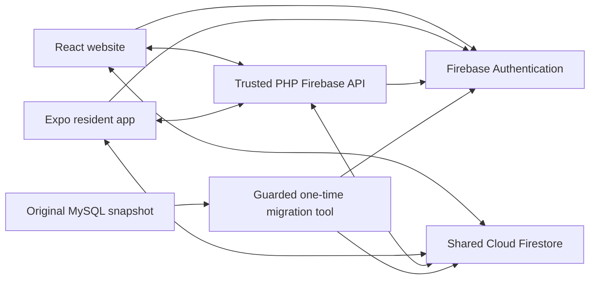

# Barangay Health Center Survey System — migration report

## Overview and original system

The project migrates the original PHP/MySQL health-center survey application to a React website and adds an Expo React Native resident app. Original PHP screens remain the UI/behavior reference. Staff and administrators manage surveys, reports, residents, requests, archives and accounts on the website; residents use either app for their own profile and surveys. Mobile registration is the intentional new resident feature.

## Actual architecture

Both apps target the existing barangay-survey-1cc7d Firebase project, Standard Firestore Native in asia-southeast1. The trusted API preserves private ID aliases, original server validation, password policy, audit authority, account provisioning/lifecycle and review/cascade operations. React is the website UI. MySQL and legacy PHP sessions are absent from the completed app's data path; the PHP Firebase API remains an explicit runtime dependency. Static Firebase Hosting alone cannot execute it. Spark-only scope uses no Cloud Functions or assumed Firebase Storage.

## Migration process

1. Inventoried 15 SQL tables, relationships, schema additions, original screens and API rules; see firebase-migration.md and migration-analysis.md.
2. Defined equivalent document/subcollection paths, deterministic identities, calendar date semantics, security validators and query indexes.
3. Built read-only SQL export, transform and guarded import tooling, tested against local Auth/Firestore emulators first. Recorded rehearsal: 235 source rows, 273 documents, seven Auth users; matching counts and idempotency. See migration-verification.md. Production import is still pending.
4. Replaced resident reads, survey submission, profile/contact/proposals/photos and staff survey management with Firebase services and the narrow trusted API.
5. Added projected snapshot-consistent dashboard/results/reports, then resident/staff provisioning, lifecycle sagas, approvals, archives, residency history and staff profile functions while preserving web markup/messages.
6. Built Expo resident screens/services against the same schema and validator, including all four question types, profile/family proposals, compressed photos, persistence and password lifecycle.
7. Hardened actor-lock and survey-version/deletion protections, tested real local services and began bidirectional app verification. Actual results and remaining device/live checks are in testing-results.md.

## SQL to Firestore mapping

| Original table | Firebase destination |
| --- | --- |
| residents | users/{uid}, residents/{uid}, private identifier aliases |
| staff | users/{uid}, staff/{uid}, private identifier aliases |
| surveys | surveys/{surveyId} |
| survey_questions | surveys/{surveyId}/questions/{questionId} |
| survey_choices | questions/{questionId}/choices/{choiceId} under survey |
| responses | responses/{surveyId_residentUid} |
| survey_results | responses/{responseId}/answers/{questionId} |
| resident_children | residents/{uid}/children/{id} |
| resident_character_references | residents/{uid}/characterReferences/{id} |
| resident_update_requests | nameAddressRequests/{id} |
| resident_family_requests | familyRequests/{id}, ordered people subcollections |
| resident_delete_requests | deletionRequests/{id} |
| staff_update_requests | staffRequests/{id} |
| resident_residency_changes | residencyRecords/{id} |
| login_history | loginHistory/{id} |

Supporting collections include counters, pendingRequests, profileImages (migrated fallback), accountOperations and accountLocks. Trusted required-question metadata lives under surveys/{id}/validation/response, while resumable survey deletion uses management/deletion. Full typed field tables and sanitized examples are maintained in firebase-migration.md; firestore.rules and firestore.indexes.json are the executable definitions. No resident values or credentials belong in example documents.

## Authentication and authorization

Firebase Email/Password owns credentials; issued Resident/Staff Numbers and usernames resolve through private normalized aliases to hidden canonical addresses. One login form retains original role redirects and onboarding gates. users documents supply role/activity/archive/setup state; callers cannot choose an authoritative role, audit actor, number or alias.

New mobile residents register with a chosen password and an issued Resident Number; staff-created residents and staff accounts retain identifier temporary-password and forced-change behavior. Actual privileged password reset uses the trusted API. Hidden canonical addresses are not usable password-recovery mailboxes. Auth/Firestore changes cannot share a transaction, so private operation records, target locks, disabled/inactive intermediate states and retry UUIDs protect partial failures. Reset/archive guards apply to SDK and verified API callers. Password setup clears only after Auth succeeds; clients wait for SDK reauthentication before refreshing the session.

Rules deny unknown paths, validate types/bounds/ownership, restrict resident data to owner, and enforce immutable one-response-per-open-survey transactions with owned choices and required-answer proofs. Question/choice edits advance parent versions; raw SDK survey deletion is refused so trusted leaf-first cascade cleanup is used. Account-operation collections remain private. Rules are still a reviewed-and-tested prototype, not a guarantee against all attacks; privileged API paths require their own tests because Admin operations bypass Firestore rules.

## Photos, dates and consistency

Photos use bounded JPEG data in Firestore, at most 256 px per side and 60 KiB compressed bytes for new images, with independent server checks. Migrated fallback images remain until replacement/removal. Both apps use Manila calendar dates, the same pure response validation source, deterministic response IDs and online transactions. There is no silent offline submission queue.

## Verification and limits

See testing-results.md for actual suites and PASS/PENDING rows. Local rule/API/browser and platform-export checks are substantial; physical iPhone and real-project cutover remain separate evidence. Source-data warnings preserved in rehearsal include ownerless historical correction requests, removed audit actors and one missing image; no owners/photos are fabricated or old records deleted automatically.

The user explicitly approved the real cutover and preservation of documented source warnings. The saved, matching emulator-verified snapshot was imported into the previously empty existing project: 273 exact documents and seven Auth identities; all seven BCRYPT hashes retained with no fallback/reset. A second import wrote zero documents, advanced zero counters and reused all seven identities. Final rules are deployed and source-verified; all 29 composite indexes are READY. See live-migration-verification.md and live-firebase-state.json.

A separate local real-project website/API runs on port 8788 and renews server access through a private token file outside the repository/document root. The external Admin credential never enters PHP or either client. The resident-only LAN gateway uses port 8793; Auth/Firestore connect directly over TLS. Twenty-eight live token/API/rule read checks cover four residents, two staff and one administrator without Firestore writes. These checks use locally signed custom tokens and do not establish an original known-password login. Physical iPhone flows and final media remain pending. Public HTTPS hosting and APK builds are optional; Expo Go remains the mobile demonstration target. Screenshot lists/scripts do not substitute for actual media.
